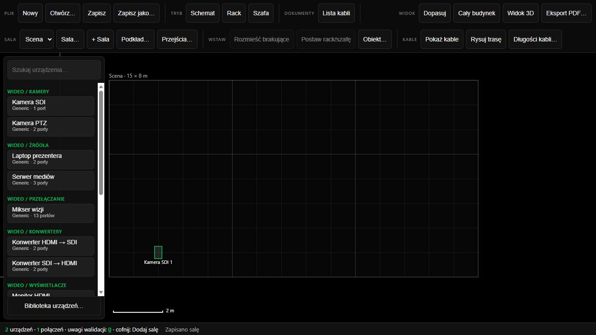
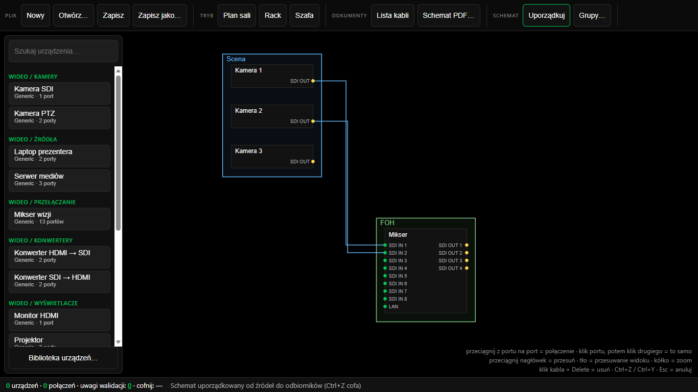
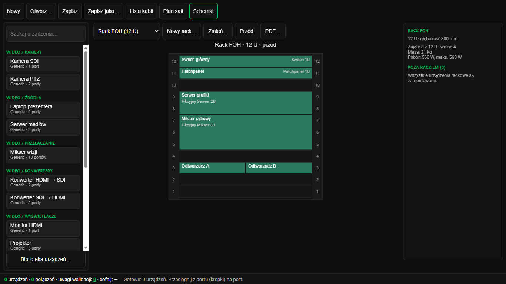
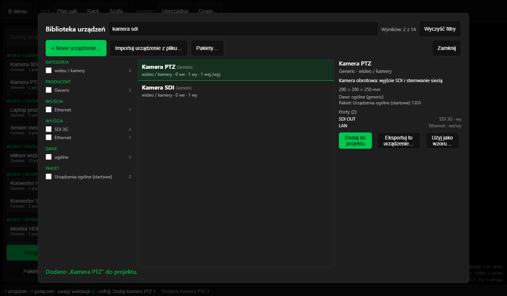
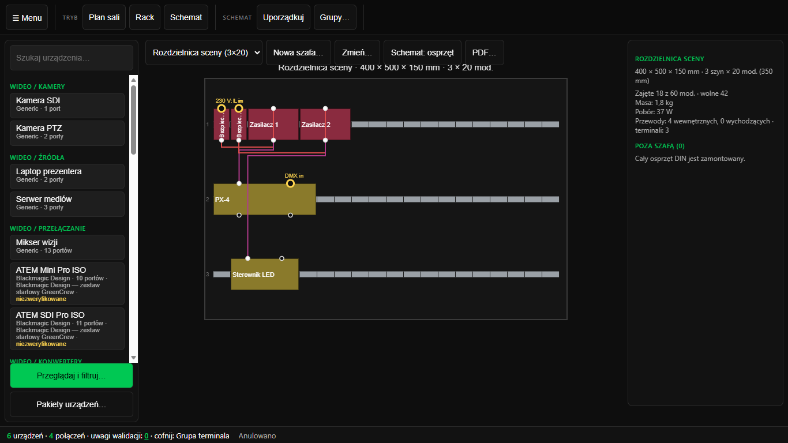
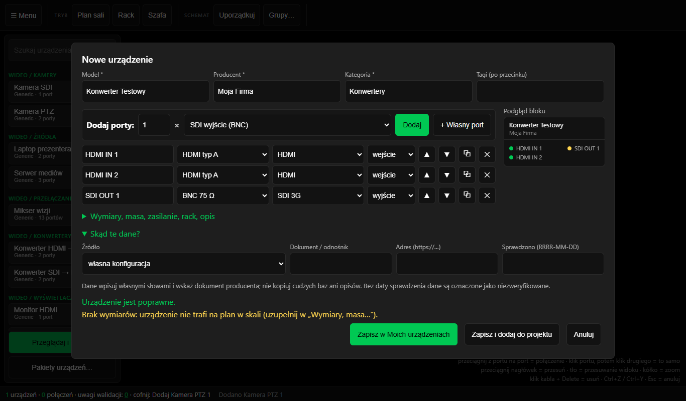

<p align="center"></p>

# StageWire

[](CHANGELOG.md)
[](https://github.com/DjGreenKrk/StageWire/releases/tag/v0.0.1)
[](#pobieranie)
[](https://tauri.app)
[](stagewire/package.json)
[](docs/mvp/PRODUCT-VISION.md)
[](LICENSE)
[](https://github.com/DjGreenKrk/StageWire/actions/workflows/ci.yml)
[](https://greencrew.pl)

StageWire to darmowe narzędzie do technicznego projektowania wydarzeń: plan sali w skali, urządzenia z prawdziwymi portami, schemat blokowy, kable, racki i szafy oraz zestawienia do wydruku. To program do projektowania, nie wizualizator.

Działa **offline-first**: nie wysyła żadnych danych, nie ma telemetrii ani kont. Projekty to pliki `.sw` na Twoim dysku. Aplikacja desktopowa na **Windows** (Tauri 2).

> **Wersja robocza (0.0.1).** Format projektu `1.0.0-draft` może się jeszcze zmienić. Aplikacja jest testowana na Windows; instalator nie jest podpisany.



## Co potrafi

- **Plan sali w skali** — wiele sal w jednym projekcie, własny obrys, scena, widownia, schody, podkład z pliku (PDF, DXF, obraz), poziom podłogi sali, blokowanie obiektów.
- **Urządzenia z rzeczywistymi portami** — katalog z opisami z dokumentacji producentów (pakiet startowy i zestaw Blackmagic Design), własne urządzenia, pakiety `.swpack.json`.
- **Biblioteka z filtrami** — przeglądarka z filtrami kategorii, producenta, wejść i wyjść, wiarygodności danych i pakietu; kreator własnego urządzenia, eksport i import pojedynczych urządzeń.
- **Schemat blokowy** — połączenia po portach, grupy w ramkach, automatyczne porządkowanie, kolory kabli według rodzaju sygnału.
- **Racki** — widok z przodu, z tyłu i z góry, moduły 3U.
- **Szafy i rozdzielnice na szynę DIN** — gotowe obudowy (np. 2 × 12 i 3 × 18 modułów), osprzęt układany na szynach (1 moduł = 17,5 mm), przewody między portami, terminale szafy, bilans modułów, masy i poboru, PDF.
- **Widok 3D** — podgląd sali, trasy kabli po bryłach.
- **Kable** — trasy między salami, długości, lista kabli.
- **Eksport** — PDF planu (z numeracją i spisem elementów), schematu, racków i szaf; wersja czarno-biała lub kolorowa z legendą kabli; lista kabli CSV. Nazwa pliku zawiera nazwę projektu i obiektu.
- **Bezpieczeństwo danych** — zapis atomowy, kopie robocze obok pliku (`.autosave`), kopie zapasowe, migracje formatu zamiast resetu.

| Schemat | Rack | Biblioteka |
|---|---|---|
|  |  |  |

| Rozdzielnica na szynę DIN | Kreator urządzenia |
|---|---|
|  |  |

## Pobieranie

Gotowe pliki znajdziesz w [Releases](https://github.com/DjGreenKrk/StageWire/releases/latest):

- **Instalator** — `StageWire-vX_Y_Z-windows-setup.exe`
- **Wersja przenośna** — `StageWire-vX_Y_Z-windows.zip`, rozpakuj i uruchom `stagewire.exe`, bez instalacji.

Instalator nie jest jeszcze podpisany certyfikatem, więc Windows SmartScreen może ostrzec o nieznanym wydawcy. Sumy SHA-256 podajemy w opisie każdego wydania.

## Pierwsze kroki

1. **Nowy projekt** z menu ☰.
2. Dodaj salę i narysuj jej obrys, ustaw skalę (z podkładu albo ręcznie).
3. Wstaw urządzenia z katalogu (klawisz **G** otwiera przeglądarkę biblioteki).
4. Połącz porty na schemacie, ułóż urządzenia w rackach i na planie.
5. Wyeksportuj dokumentację z menu ☰.

## Dokumentacja

Specyfikacja, decyzje projektowe i model danych: [docs/mvp/README.md](docs/mvp/README.md).

- [Wizja produktu](docs/mvp/PRODUCT-VISION.md)
- [Zakres MVP](docs/mvp/MVP-SCOPE.md)
- [Architektura](docs/mvp/ARCHITECTURE.md)
- [Rejestr decyzji (ADR)](docs/mvp/DECISIONS.md)
- [Baza urządzeń i format pakietów](docs/mvp/DEVICE-DB.md)

## Licencja

StageWire jest udostępniany na warunkach [PolyForm Shield License 1.0.0](https://polyformproject.org/licenses/shield/1.0.0). Pełny tekst: [LICENSE](LICENSE), omówienie w praktyce: [LICENSING.md](LICENSING.md). To licencja *source-available*, nie open source w rozumieniu OSI. Składniki zewnętrzne: [THIRD_PARTY_LICENSES.md](THIRD_PARTY_LICENSES.md).

© Julian Szymański / GreenCrew. Część ekosystemu GreenCrew Tools. Marka i standardy: [BRANDING.md](BRANDING.md).

---

## Dla deweloperów

### Struktura repozytorium

```text
.
├── docs/mvp/           specyfikacja, ADR, model danych
├── stagewire/
│   ├── src/            rdzeń: model, format, walidacja, eksporty (bez UI, testowalny w Node)
│   ├── web/            interfejs (Canvas 2D, edytor)
│   ├── src-tauri/      powłoka Tauri 2 (Rust)
│   ├── schema/         schemat JSON projektu i pakietów
│   ├── packs/          przykładowy pakiet urządzeń
│   ├── test/           testy jednostkowe (vitest)
│   └── bench/          testy interfejsu (Playwright) i pomiary wydajności
└── .github/            CI, szablony zgłoszeń
```

### Wymagania

- Node.js 22 i npm,
- Rust (stable) oraz zależności Tauri 2 dla Windows (WebView2, narzędzia C++ MSVC) — tylko do budowy aplikacji,
- przeglądarka Microsoft Edge — tylko do testów interfejsu (`bench/test-*-ui.mjs`).

### Uruchomienie

```powershell
cd stagewire
npm ci
npm test            # testy jednostkowe
npm run typecheck   # sprawdzenie typów
npm run build:web   # budowa interfejsu
npm run build:app   # aplikacja Tauri (bez instalatora)
npx tauri build     # aplikacja i instalator NSIS
```

Testy interfejsu uruchamiasz pojedynczo, np. `node bench/test-libbrowser-ui.mjs`. Walidator schematu jest generowany poleceniem `npm run gen:validator` (uruchamia się samo przed testami); test `validator-fresh` pilnuje, żeby był aktualny.

Zasady współpracy: [CONTRIBUTING.md](CONTRIBUTING.md). Zgłaszanie podatności: [SECURITY.md](SECURITY.md). Historia zmian: [CHANGELOG.md](CHANGELOG.md).
