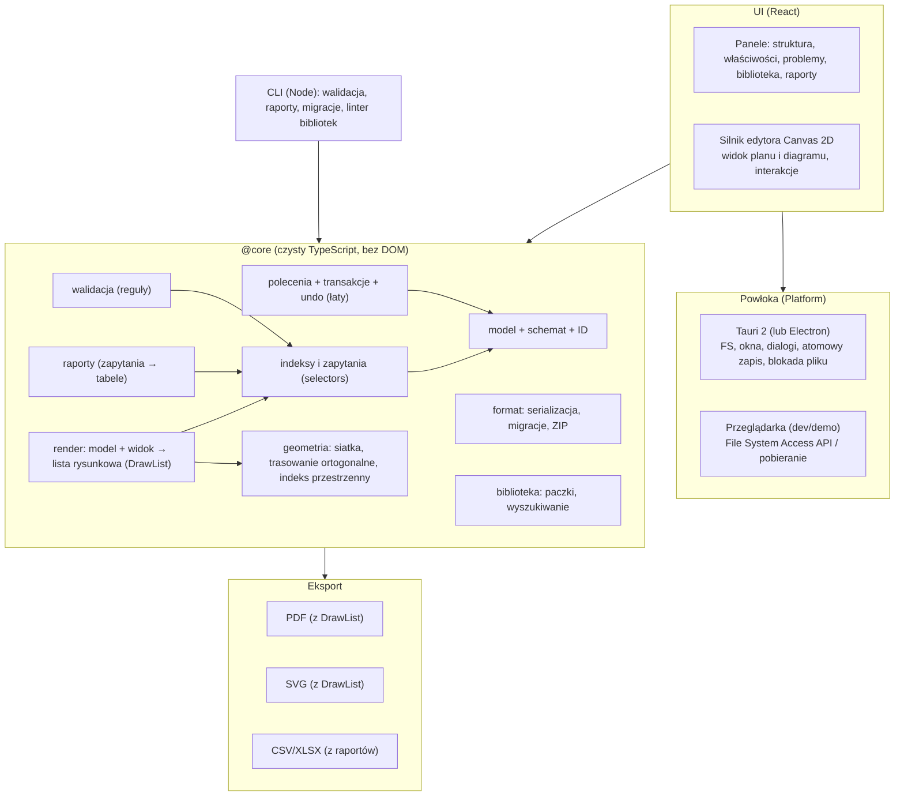
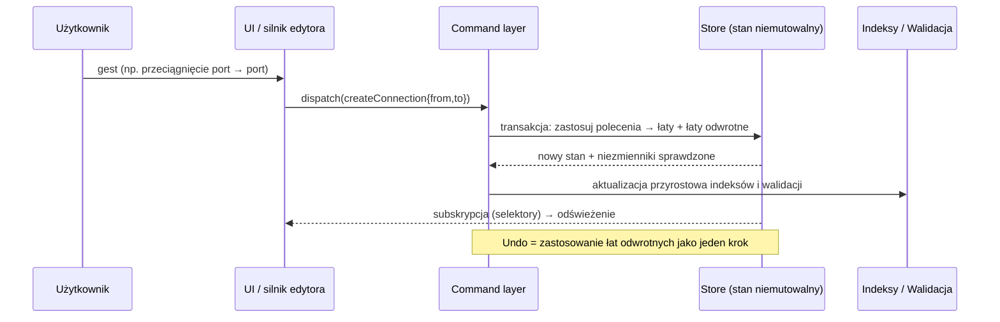

# ARCHITECTURE — architektura i wybór technologii

Status: wersja 0.1 do audytu · 2026-10-31

Oceny technologii poniżej to **oceny eksperckie bez pomiarów** ([HIPOTEZA]). Stan wersji i licencji zależności trzeba zweryfikować w Etapie 0 (IMPLEMENTATION-PLAN). Kluczowe założenia wydajnościowe i platformowe weryfikuje PoC, nie ten dokument. Wnioski `W-xx`: wewnętrzne materiały badawcze Decyzje: [DECISIONS.md](DECISIONS.md).

## 1. Wymagania sterujące architekturą

| # | Wymaganie | Źródło |
|---|---|---|
| A1 | Offline-first, bez konta i serwera | PRODUCT-VISION §5 |
| A2 | Windows i Linux, także starsze komputery | zamówienie §2, §8 |
| A3 | Rysowanie w rzeczywistej skali, tysiące obiektów i połączeń | zamówienie §8 |
| A4 | Eksport wektorowy PDF/SVG | zamówienie §8 |
| A5 | Model niezależny od widoków; poleceniowa edycja z cofaniem | DOMAIN-MODEL Z3, Z4 |
| A6 | Otwarty, wersjonowany format; przenośny plik | DOMAIN-MODEL §10 |
| A7 | Łatwość testowania modelu bez GUI | zamówienie §8 |
| A8 | Niski koszt utrzymania, zależności o przyjaznych licencjach | zamówienie §2, §8 |
| A9 | Możliwość przyszłej synchronizacji/self-hostingu/eksportu IFC bez przepisywania | zamówienie §1, §5 |
| A10 | Brak wymogu 3D, brak wymogu konkretnej technologii | zamówienie §1, §2 |

## 2. Rozważane podejścia

| ID | Podejście | Skrót |
|---|---|---|
| **T1** | Rdzeń w TypeScript + UI webowe (React) z własnym silnikiem Canvas 2D, w powłoce **Tauri 2** | TS + Tauri |
| **T2** | To samo, w powłoce **Electron** | TS + Electron |
| **T3** | Natywnie w **Rust** (egui/Slint/iced) | Rust native |
| **T4** | **.NET** + Avalonia (MIT) + SkiaSharp | .NET |
| **T5** | **Qt 6** (C++ lub PySide6) z QGraphicsView | Qt |
| **T6** | **Aplikacja przeglądarkowa/PWA** bez powłoki desktopowej | PWA |

### 2.1 Macierz oceny

Skala 1–5 (5 = najlepiej). Uzasadnienia są kluczowe, liczby tylko porządkują. **Pogrubione** komórki to główne czynniki decyzji.

| Kryterium | T1 TS+Tauri | T2 TS+Electron | T3 Rust native | T4 .NET+Avalonia | T5 Qt | T6 PWA |
|---|---|---|---|---|---|---|
| Edytor grafowy / canvas 2D (dostępne klocki) | 4 | 4 | 2 | 3 | **5** | 4 |
| Rysowanie w rzeczywistej skali, eksport wektorowy | 4 | 4 | 3 | 4 | **5** | 4 |
| Tysiące obiektów (wydajność na starszych maszynach) | 3 | 3 | **5** | 4 | **5** | 3 |
| Zapis lokalny, offline-first | 5 | 5 | 5 | 5 | 5 | **2** (ograniczenia dostępu do plików, magazyn może być wywłaszczony) |
| Windows + Linux | **3** (zależność od WebKitGTK na Linuxie) | **5** (Chromium spójny) | 4 | 4 | 4 | 4 |
| Łatwość testowania modelu bez GUI | **5** (czysty TS w Node) | **5** | 4 | 4 | 3 | 5 |
| Koszt utrzymania / pula współtwórców | **4** | 4 | 2 | 3 | 3 | 4 |
| Rozmiar i zasoby (starsze maszyny) | 4 | 2 | 5 | 3 | 3 | 5 |
| Licencje zależności | 5 (MIT/Apache) | 5 | 5 | 5 (Avalonia MIT) | 3 (LGPL/GPL lub komercyjna; ograniczenia statycznego linkowania) | 5 |
| Droga do synchronizacji / self-hostingu | **5** (ten sam TS po obu stronach, CRDT) | 5 | 3 | 3 | 2 | **5** |
| Droga do eksportu IFC / integracji | 4 | 4 | 4 | 4 | 3 | 4 |
| Ryzyko techniczne (znane niewiadome) | 3 | **4** | 3 (młode ekosystemy GUI) | 3 | 4 | 3 |

### 2.2 Dyskusja

**T1 (TS + Tauri) — rekomendowane.** Cały rdzeń (model, polecenia, walidacja, raporty, format, renderowanie do list rysunkowych) w czystym TypeScript, niezależny od powłoki: testy w Node bez przeglądarki, narzędzie CLI w Node, ta sama logika w przyszłym serwerze synchronizacji. Interfejs w React ma największą pulę współtwórców. Tauri daje mały pakiet i niskie zużycie pamięci względem Electrona. **Główne ryzyko:** na Linuxie Tauri używa systemowego WebKitGTK; jego wydajność canvas/SVG i zgodność wersji bywają gorsze niż Chromium, szczególnie na starszych dystrybucjach i sterownikach (wiedza ogólna społeczności, nie pomiar w tym projekcie). Dlatego wybór powłoki jest **bramką decyzyjną w PoC-3** (§12).

**T2 (TS + Electron) — plan awaryjny dla T1.** Ten sam kod UI. Spójny silnik renderujący na obu systemach eliminuje ryzyko WebKitGTK kosztem większej paczki i pamięci. Jeśli PoC-3 wykaże problem na Linuxie, przechodzimy na T2 bez zmiany rdzenia, bo powłoka jest cienka (interfejs `Platform`, §6).

**T3 (Rust native).** Najlepsza wydajność, ale brak dojrzałych gotowych komponentów edytora diagramów i paneli właściwości; wysoki koszt GUI i testów interakcji; mała pula współtwórców spoza ekosystemu Rust. Uzasadnione dopiero, gdyby PoC wykazał, że webowy renderer nie spełnia celów wydajności.

**T4 (.NET + Avalonia).** Dobre wsparcie desktopowe i SkiaSharp. Rozsądna alternatywa, ale oddzielenie rdzenia od UI jest mniej naturalne dla przyszłego serwera i przeglądarkowej demonstracji; testy interakcji i eksport PDF wymagają dobrania dodatkowych bibliotek, których licencje (np. niektóre generatory PDF) trzeba by sprawdzić.

**T5 (Qt).** Technicznie najlepsze klocki dla edytora 2D w skali (QGraphicsView, drukowanie, SVG). Przeszkody: licencje (LGPL/GPL vs komercyjna, wymagania dynamicznego linkowania dla zachowania swobody licencyjnej), mniejsza pula współtwórców webowych, droższa droga do przeglądarki/serwera. Dobry kandydat, gdyby projekt chciał pozostać czysto desktopowy i miał C++/Python-owy zespół.

**T6 (PWA).** Świetny dla self-hostingu i zerowej instalacji, ale **offline-first z plikami lokalnymi** jest tu słabym punktem: File System Access API nie jest dostępne w każdej przeglądarce, magazyn przeglądarki może zostać wywłaszczony, a użytkownik oczekuje „pliku na dysku". Pozostaje jako **tryb dodatkowy**: ta sama aplikacja uruchamiana w przeglądarce (do rozwoju i demonstracji), nie jako cel główny.

### 2.3 Rekomendacja

> **T1 — rdzeń TypeScript, UI React, własny silnik Canvas 2D, powłoka Tauri 2, z bramką PoC-3 i planem awaryjnym T2.** Format projektu: ZIP z JSON-ami. Brak serwera w MVP.

Dlaczego nie „popularne z automatu": wybór podyktowały (1) testowalność modelu bez GUI, (2) niski próg współtwórców, (3) droga do synchronizacji/serwera na tym samym kodzie, (4) niski koszt licencyjny. Wybór nie zakłada, że React czy Tauri są najszybsze, lecz że ryzyka (wydajność canvas, WebKitGTK) są **mierzalne w PoC, a konsekwencje porażki tanie** (wymiana powłoki lub renderera za interfejsem).

### 2.4 Platformy docelowe (poprawka audytu P1-11)

„Starszy komputer/Linux" nie jest kryterium. Wymagania sprawdzalne (propozycja do zatwierdzenia, Q-09): Windows 10 22H2 / 11 z WebView2; Linux Ubuntu 22.04 LTS i 24.04 LTS z systemowym `webkit2gtk-4.1` (Tauri 2 wymaga tej biblioteki; starsze wydania jak 20.04 nie są celem); GPU zintegrowane Intel; sprzęt referencyjny podaje właściciel. Benchmark PoC-2/PoC-3 wykonujemy dopiero po ustaleniu tej listy. Wersje zależności systemowych do potwierdzenia w Etapie 0.

## 3. Architektura warstwowa



### 3.1 Zasady

1. **`@core` nie zna przeglądarki ani powłoki.** Działa w Node i w przeglądarce. Dzięki temu cały model, polecenia, walidacja, raporty i migracje są testowane szybkimi testami jednostkowymi i własnościowymi (A7).
2. **Jedyna droga zmiany modelu to polecenie.** UI nie mutuje stanu (DOMAIN-MODEL Z4).
3. **Jeden potok renderowania dla ekranu i eksportu:** `model + widok → DrawList` (czysta funkcja). Canvas 2D rysuje `DrawList` na ekranie, a eksport PDF/SVG tłumaczy tę samą listę na prymitywy wektorowe. Eliminuje rozjazd „co widać" vs „co wydrukowano" i daje testy golden bez GUI (ADR-017).
4. **Powłoka za interfejsem `Platform`:** otwieranie/zapis plików, dialogi, ścieżki, blokada, autozapis, schowek, otwarcie PDF. Dwie implementacje: Tauri i przeglądarka. Wymiana na Electron = nowa implementacja interfejsu.

## 4. Przepływ danych i polecenia



- **Stan:** niemutowalny (structural sharing), mutacje przez bibliotekę łat (np. Immer, licencja MIT). Każda transakcja daje listę łat i łat odwrotnych: podstawa cofania, a w przyszłości dziennika operacji dla synchronizacji (ADR-015, ADR-022).
- **Niezmienniki** (DOMAIN-MODEL §6) są sprawdzane na końcu transakcji; naruszenie = odrzucenie transakcji i błąd programistyczny (nie komunikat dla użytkownika).
- **Operacje złożone** (usuń z kaskadą, upgrade definicji) budują jedną transakcję z podglądem skutków (`plan()` zwraca opis skutków bez zastosowania).
- **Indeksy:** `connectionsByPort`, `instancesByDefinition`, `placementByTarget`, indeks przestrzenny (R-drzewo) per widok. Aktualizowane przyrostowo po łatach.
- **Walidacja:** reguły deklarują, jakie obiekty czytają; po transakcji przeliczane są tylko reguły i obiekty dotknięte łatami. Przy dużych projektach można ją przenieść do Web Workera (granica jest już czysta).
- **Raporty:** zapytania nad indeksami; wyniki nie są przechowywane (ADR-018).

## 5. Format pliku i trwałość

### 5.1 Kontener

```
projekt.stagewire            (ZIP, rozszerzenie robocze)
├── manifest.json            formatVersion, appVersion, createdAt, hash zawartości
├── project.json             cały model (kanoniczna serializacja)
├── views/ (opcjonalnie)     view.<id>.json jeśli duże (próg rozmiaru)
├── assets/                  podkłady (PNG/JPG/SVG/PDF), logo
└── library/                 (opcjonalnie) osadzone paczki w całości
```

- **Dlaczego ZIP + JSON, a nie SQLite lub katalog:** otwarty, czytelny w dowolnym narzędziu, diffowalny po rozpakowaniu, łatwa migracja funkcjami czystymi, jeden plik do przeniesienia (wymaganie §1 pkt 7). Rozmiar projektu typowego (setki urządzeń) to megabajty i ładuje się w całości do pamięci **[HIPOTEZA, do zmierzenia w PoC-1]**. SQLite byłby lepszy przy setkach tysięcy obiektów lub częściowym ładowaniu, czego scenariusze nie wymagają.
- **Wymienność magazynu:** dostęp przez port `ProjectStore` (`load`, `save`, `listBackups`). Jeśli pomiary pokażą granice formatu, wymiana na SQLite nie zmienia reszty (ADR-014; kryterium rewizji w §12).
- **Tryb katalogu** (`export --dir`: po jednym pliku JSON na obiekt) jako opcja dla zespołów używających git — po MVP.

### 5.2 Zapis i odzyskiwanie

1. **Zapis atomowy:** zapis do pliku tymczasowego w tym samym katalogu → `fsync` → zamiana na docelowy (rename/replace). Implementacja w powłoce (Rust: biblioteka plików tymczasowych z trwałym przeniesieniem). Stary plik pozostaje nienaruszony do chwili zamiany (cel: TS-04).
2. **Kopie zapasowe:** przed nadpisaniem poprzednia wersja do `<projekt>.backups/` (rotacja N, domyślnie 5) — wzorzec stosowany w narzędziach CAD, z kontrolą atomowości.
3. **Autozapis:** co N sekund (domyślnie 30) i po okresie bezczynności zapis stanu do katalogu odzyskiwania w danych aplikacji (nie dotyka pliku użytkownika). Przy starcie aplikacja wykrywa osierocony autozapis i proponuje odzyskanie.
4. **Blokada doradcza:** plik `.lock` z użytkownikiem, komputerem i czasem (jak), wyłącznie ostrzegawczy, z wykrywaniem „starej" blokady; nie uniemożliwia pracy.
5. **Brak własnego pomijania zapisu przy braku sieci** (inaczej niż): zapis jest lokalny i niezależny od sieci.

#### Gwarancje trwałości i scenariusze awarii (poprawka audytu P1-06)

**ZIP nie jest sam w sobie odporny na uszkodzenia:** uszkodzony katalog centralny może uniemożliwić odczyt całego archiwum. Odporność zapewniają procedura zapisu i kopie, nie format. Niczego z poniższego nie deklarujemy bez testu na Windows i Linuxie osobno (TS-04).

| Scenariusz | Gwarantowane zachowanie (cel) | Mechanizm | Uwagi platformowe do zbadania w PoC-3 |
|---|---|---|---|
| Zabicie procesu w trakcie zapisu | Plik docelowy w poprzednim, całym stanie | Zapis do pliku tymczasowego w tym samym katalogu, `fsync` pliku, **weryfikacja po zapisie** (ponowne otwarcie i walidacja sumy), dopiero potem zamiana | Linux: `rename` jest atomowy w obrębie systemu plików, dodatkowo `fsync` katalogu nadrzędnego. Windows: zamiana przez `ReplaceFile`/`MoveFileEx` z ponowieniami przy blokadzie (antywirus, indeksowanie) |
| Brak miejsca na dysku | Błąd zapisu zgłoszony użytkownikowi, plik docelowy nietknięty, autozapis niedostępny jest sygnalizowany | Zapis tymczasowy kończy się błędem przed zamianą | Sprawdzić zachowanie przy `ENOSPC` / `ERROR_DISK_FULL` |
| Brak uprawnień do zapisu | Propozycja „Zapisz jako…" w innym miejscu; praca nie jest tracona | Autozapis do katalogu danych aplikacji | |
| Zasób sieciowy / dysk wymienny odłączony | Ostrzeżenie; kopia robocza w katalogu odzyskiwania | Autozapis lokalny | Zachowanie `rename` na udziałach sieciowych bywa nieatomowe: oznaczyć jako nieobsługiwane lub ostrzegać |
| Dwa procesy na jednym pliku | Ostrzeżenie o blokadzie doradczej; brak gwarancji przy ręcznym obejściu | Plik `.lock` (użytkownik, komputer, czas) | Blokada doradcza **nie zapobiega** konfliktowi; ostatni zapis wygrywa po potwierdzeniu użytkownika |
| Uszkodzony plik projektu | Propozycja odzyskania z ostatniej kopii lub autozapisu; nigdy automatyczne nadpisanie | Rotacja N kopii + weryfikacja przy otwarciu | Możliwe uszkodzenie katalogu ZIP: kopie przechowywane jako osobne, w całości zweryfikowane pliki |
| Awaria zasilania | Utrata ≤ okres autozapisu (domyślnie 30 s) | Autozapis okresowy | Zależy od `fsync` i cache dysku, nie gwarantujemy więcej niż system plików |

### 5.3 Migracje i zgodność

Nowszy MAJOR: metadane + ostrzeżenie, bez zapisu i migracji; nieznane pola przy zgodnym MINOR są zachowywane, co nie oznacza rozumienia ich semantyki (DOMAIN-MODEL §10).

Funkcje czyste `vN → vN+1`, testowane na plikach wzorcowych; zachowanie nieznanych pól; schemat JSON Schema jako specyfikacja normatywna (DOMAIN-MODEL §10, ADR-014). Walidacja schematu przy wczytaniu z raportem błędów (nie awaria).

### 5.4 Biblioteka

- Paczka biblioteki = katalog JSON (`pack.json` + definicje + rejestry) z metadanymi: nazwa, wersja, licencja, źródła, autorzy.
- Wbudowana paczka startowa wysyłana z aplikacją; paczki użytkownika w katalogu danych; import z pliku.
- **Projekt osadza użyte rewizje definicji** (przenośność, ADR-004). Biblioteka jest źródłem, nie zależnością plikową.
- Indeks wyszukiwania lokalny (np. MiniSearch, MIT) z fasetami budowanymi z danych; dla 5 000–20 000 definicji wystarczy (cel TS-08). Zastępuje zewnętrzny silnik wyszukiwania, który bywa potrzebny przy centralnej bazie, a nie przy bibliotece lokalnej.
- Linter paczek w CLI: schemat, niepuste pochodzenie i licencja, unikalność ID portów, normalizacja producenta (G8).

## 6. Interfejs `Platform` (powłoka)

| Funkcja | Tauri | Przeglądarka (dev/demo) |
|---|---|---|
| Otwórz/zapisz plik, dialogi | tak | File System Access API lub pobieranie/wgrywanie |
| Zapis atomowy, blokada, kopie | tak (Rust) | ograniczone |
| Katalog danych aplikacji, autozapis | tak | IndexedDB (tylko autozapis) |
| Aktualizacje | brak w MVP | n/d |
| Rejestracja skojarzenia pliku | instalator | n/d |

Zasada: UI nie importuje API Tauri bezpośrednio.

## 7. Silnik edytora i renderowanie

### 7.1 Wybór renderera ekranowego

| Opcja | Zalety | Wady |
|---|---|---|
| **DOM + SVG** | Trafienia i dostępność „za darmo"; prosta implementacja | Koszt DOM przy tysiącach elementów, wydajność niezmierzona [W-01]; skalowanie linii i tekstu wymaga uwagi |
| **Canvas 2D + własny indeks** | Przewidywalna wydajność, pełna kontrola, ta sama DrawList do eksportu | Własne trafienia i nakładki, brak darmowej dostępności |
| **WebGL (np. PixiJS)** | Największa wydajność | Złożoność, ryzyko sterowników na starszych komputerach, eksport wektorowy osobno |

**Decyzja robocza [DECYZJA]:** Canvas 2D z indeksem przestrzennym (R-drzewo) i wirtualizacją (rysowanie widocznych elementów), z DOM-owymi nakładkami na edycję tekstu i kontrolki. **Bramka PoC-2:** porównanie z bazowym wariantem SVG z wirtualizacją przy 1 000 / 2 000 / 5 000 elementów na maszynie referencyjnej; jeśli SVG spełnia cele, wybieramy prostsze rozwiązanie (ADR-017).

### 7.2 Silnik wspólny dla planu i diagramu

Wspólne: wejście (wskaźnik, klawiatura), zaznaczanie, trafienia z tolerancją (hit-area), przeciąganie z przyciąganiem, kamera (pan/zoom), wirtualizacja, nakładki. Różne: **widok planu** (współrzędne mm, siatka, linijki, wymiary, skala wydruku) i **widok diagramu** (węzły z portami, trasowanie ortogonalne). Pozwala to wspierać jednakowe zachowanie obu edytorów i zmniejsza koszt (jeden mechanizm zaznaczenia i cofania).

### 7.3 Dlaczego nie gotowa biblioteka diagramów

| Biblioteka (stan wiedzy autora, **zweryfikować**) | Uwaga |
|---|---|
| React Flow (xyflow, MIT) | Dobre uchwyty portów, ale węzły w DOM; własność stanu po stronie biblioteki koliduje z modelem opartym na poleceniach; trasowanie ortogonalne i plan metryczny i tak własne |
| maxGraph / mxGraph (Apache-2.0) | Dojrzałe, ale ciężkie, własny model dokumentu i API w starym stylu |
| JointJS (MPL-2.0 rdzeń) | Część funkcji w wersji komercyjnej |
| tldraw | Licencja nie jest typową licencją OSI-open-source (wymaga weryfikacji); odpada przy wymogu pełnej swobody |
| Konva / Fabric / PixiJS | Warstwa rysowania, nie edytor; możliwe jako backend |

Decyzja: **własny, wąski silnik** (prostokątne węzły, linie ortogonalne, kilka kształtów). Koszt budowy to największy pojedynczy koszt projektu — jest świadomie przyjęty i ograniczony zakresem; w PoC-2 mierzymy nakład względem React Flow jako opcji dla samego diagramu (kryterium rewizji: jeśli własny diagram przekroczy budżet pracy ×1,5, rozważyć React Flow dla widoku diagramu).

### 7.4 Trasowanie linii na diagramie

Ortogonalne (segmenty poziome/pionowe) między portami z wyjściem prostopadle do boku, z zaokrągleniem/fazką, rozstawem równoległych linii i ręcznymi waypointami. Bez omijania przeszkód w MVP. Trasowanie jest czystą funkcją w `@core/geometry`, więc testowalną i używaną w eksporcie.

## 8. Wydajność — założenia i budżety (do weryfikacji w PoC)

| Operacja | Cel | Uwaga |
|---|---|---|
| Otwarcie projektu 5 000 obiektów | < 2 s | zależy od parsowania JSON i budowy indeksów |
| Pan/zoom | ≥ 60 fps do 1 000 widocznych elementów, ≥ 30 fps przy 5 000 | wirtualizacja + R-drzewo |
| Polecenie → odświeżenie | < 16 ms dla typowych edycji | niezmienność + łaty |
| Walidacja przyrostowa | < 50 ms/edycja przy 2 000 urządzeń | |
| Wyszukiwanie biblioteki | < 100 ms/5 000 definicji | |
| Pamięć | < 500 MB przy 2 000 urządzeń | |

Wszystkie liczby są **hipotezami**. Sens PoC-1/PoC-2 to je potwierdzić albo skorygować, zanim zostaną „wmurowane" w wymagania.

## 9. Dostępność i lokalizacja

- Canvas nie daje dostępności za darmo (przeciwnie do DOM). Kompensacja: **panel struktury** (drzewo obiektów z etykietami tekstowymi, nawigacja klawiaturą, zaznaczanie z klawiatury), opisy `aria` dla paneli i alternatywa tekstowa dla krawędzi (lista połączeń urządzenia).
- i18n od początku: tłumaczenia w plikach, formatowanie liczb i dat wg `locale`, pierwsze języki PL i EN. Czcionki do PDF z pełnym zakresem Latin Extended-A (osadzane, licencja OFL).

## 10. Bezpieczeństwo i prywatność

- Brak telemetrii; brak ruchu sieciowego; restrykcyjna polityka CSP.
- Parsowanie plików: limity rozmiaru JSON i liczby wpisów ZIP (ochrona przed bombami), walidacja schematu, brak wykonywania treści z plików.
- Pliki podkładów traktowane jako dane niezaufane (rasteryzacja PDF w piaskownicy webview).
- Przy przyszłych wtyczkach: osobna decyzja bezpieczeństwa; MVP bez wtyczek.

## 11. Rozszerzalność (bez komplikowania MVP)

| Kierunek | Jak model go wspiera | Co **nie** wchodzi do MVP |
|---|---|---|
| **Synchronizacja / współpraca** | Stabilne ID, kolekcje jako mapy, dziennik łat z transakcji, rozdzielone dane widoków | CRDT, serwer, konta. Opcje na przyszłość: biblioteka CRDT (np. Yjs/Automerge/Loro) nad mapami lub dziennik operacji z zegarami logicznymi |
| **Self-hosting** | Ten sam TS rdzeń na serwerze Node; ZIP+JSON jako format wymiany | Serwer |
| **BIM / IFC (np. BIMCraft)** | Graf z ID: urządzenia, porty, połączenia, `Placement` XYZ + orientacja. Eksport jako adapter odczytujący model; mapowanie na byty IFC (np. urządzenia dystrybucyjne, porty, systemy) to **[HIPOTEZA]** do weryfikacji z dokumentacją IFC i BIMCraft | Eksport/import IFC; zależność od BIMCraft |
| **Unreal / 3D** | Pozycja i obrót w mm; wymiary w definicji; brak geometrii 3D | Widok 3D, silnik |
| **Oświetlenie (MVR/GDTF)** | Definicje z kategorią i atrybutami `ext`; `Placement` XYZ | Import/eksport MVR/GDTF |
| **Wtyczki** | Pole `ext` z zachowaniem nieznanych pól (Z8); reguły walidacji jako moduły | Mechanizm wtyczek |
| **Logiczne przepływy** | `attrs` na portach/połączeniach; przyszła encja warstwowa nad `Connection` | Encja `LogicalFlow` |

Uwaga ze zbadanego BIMCraft: ścisłe `deny_unknown_fields` i `lenient.rs` gubią nieznane pola; stąd nasza zasada round-trip (Z8) od pierwszego dnia.

## 12. Ryzyka techniczne i bramki decyzyjne

| # | Ryzyko | Prawdopodobieństwo/wpływ (ocena) | Wykrycie | Plan awaryjny |
|---|---|---|---|---|
| R1 | Wydajność Canvas/WebKitGTK na Linuxie i starszych komputerach | średnie / wysoki | PoC-2 i PoC-3 na maszynie referencyjnej | Electron (T2); uproszczenie rysowania; w ostateczności renderer natywny |
| R2 | Koszt własnego silnika edytora przekracza budżet | średnie / wysoki | Pomiar nakładu w PoC-2 | React Flow dla diagramu; zawężenie funkcji edytora |
| R3 | Złożoność modelu (rewizje definicji, kaskady) opóźnia UI | średnie / średni | Plaster pionowy w PoC-1 | Uproszczenie: definicje lokalne bez rewizji w MVP (F-19 wypada) |
| R4 | Eksport PDF: fonty, rozdzielczość, skala | niskie / średni | TS-07, TS-14 w PoC-3 | Inna biblioteka PDF; PDF z SVG |
| R5 | Biblioteka startowa: jakość i prawa do danych | wysokie / wysoki | Przegląd prawny (Q-07) | Mniejszy zakres, generyki, wkład społeczności z DCO |
| R6 | Format JSON zbyt duży/wolny przy dużych projektach | niskie / średni | Pomiar w PoC-1 | Podział na wpisy ZIP; SQLite za portem `ProjectStore` |
| R7 | Nadmierny zakres produktu (pełne rozwiązanie B/webowe) | wysokie / wysoki | Kontrola zakresu względem MVP-SCOPE | Odcięcie [S] w kolejności odwrotnej |
| R8 | Brak badań użytkowników → źle dobrane priorytety | wysokie / średni | Wywiady przed M2 (B1) | Korekta zakresu [S] |
| R9 | Wiedza o zależnościach (licencje, wersje) nieaktualna | średnie / średni | Audyt w Etapie 0 | Zamienniki o zgodnej licencji |
| R10 | Pliki osób trzecich ujawnione w repozytorium publicznym | średnie / wysoki (prawnie) | Przegląd repozytorium przed publikacją | Przegląd zawartości repo, `.gitignore`, ADR-020 |

**Kryteria rewizji formatu pliku:** jeśli w PoC-1 ładowanie projektu 5 000 obiektów > 2 s po optymalizacji lub zapis blokuje UI > 300 ms, rozważyć SQLite lub podział na wpisy.

## 13. Struktura repozytorium (propozycja, bez zakładania repozytorium)

```
/packages/core        model, polecenia, walidacja, raporty, format, render, geometria
/packages/library     paczka startowa + schematy
/packages/cli         narzędzia Node
/apps/desktop         UI React + powłoka (Tauri)
/docs                 specyfikacja formatu, ADR
```

Zależności jednokierunkowe: `desktop → core`, `cli → core`, `core → (brak zależności od UI/powłoki)`.

## 14. Testowanie

| Poziom | Narzędzia (propozycje) | Zakres |
|---|---|---|
| Jednostkowe | Vitest | Polecenia, walidacja, raporty, geometria, migracje |
| **Własnościowe** | fast-check (MIT) | Niezmienniki po losowych sekwencjach; cofnięcie = stan początkowy; round-trip serializacji |
| Golden files | Pliki wzorcowe | DrawList → SVG/PDF; migracje; raporty |
| Wydajność | Benchmarki w Node i w przeglądarce | Cele z §8 |
| E2E | Playwright (Apache-2.0) na buildzie web; smoke na Tauri | TS-01, TS-04, TS-09 |
| Ręczne | Lista kontrolna scenariusza referencyjnego | TS-01 z osobą z zewnątrz |

CI nie jest tu konfigurowane (poza zakresem tego etapu); plan zakłada jego uruchomienie w Etapie 0 repozytorium.

## 15. Zależności i licencje (do audytu)

| Obszar | Kandydat | Licencja (wg wiedzy autora; **zweryfikować**) |
|---|---|---|
| UI | React, Radix UI | MIT |
| Powłoka | Tauri 2 | Apache-2.0 / MIT |
| Stan/łaty | Immer | MIT |
| ZIP | fflate | MIT |
| Schemat/walidacja | TypeBox + Ajv | MIT |
| Indeks przestrzenny | rbush | MIT |
| Wyszukiwanie | MiniSearch | MIT |
| PDF | pdf-lib + fontkit | MIT |
| Rasteryzacja PDF podkładu | pdf.js | Apache-2.0 |
| Testy | Vitest, fast-check, Playwright | MIT / MIT / Apache-2.0 |
| Czcionki | Inter / Noto (OFL) | OFL-1.1 |
| XLSX (opcja S) | exceljs lub wygenerowanie CSV | MIT / do oceny |

Każda zależność wymaga potwierdzenia licencji i aktualnego stanu utrzymania w Etapie 0.

## Dodatek A — porównanie z Flutter Desktop (standard rodziny GreenCrew Tools)

Dodany po zapoznaniu się z `GreenCrew_Tools_Docs`, gdzie standardem jest Flutter/Dart (Q-23). Właściciel zdecydował (2026-11-01), że StageWire zostaje przy **TypeScript i React** jako udokumentowanym wyjątku produktowym (ADR-034). Poniżej uzasadnienie i warunki, przy których warto wrócić do tematu. Oceny są **eksperckie, niemierzone [HIPOTEZA]**.

| Kryterium | T1 TypeScript + React + Tauri | T7 Flutter Desktop (Windows/Linux) |
|---|---|---|
| Zgodność ze standardami rodziny, wspólne komponenty `GreenCrew*` | wyjątek; komponenty trzeba odtworzyć w React wg design systemu | **pełna** |
| Edytor 2D (własny canvas, trafienia, przeciąganie) | Canvas 2D + własny indeks; dobre biblioteki pomocnicze | `CustomPainter`; dobra wydajność, własny silnik także potrzebny |
| Linux | zależność od systemowego WebKitGTK (ryzyko R1) | własny renderer, zależność od GTK; **brak ryzyka WebKitGTK** |
| Telefon jako platforma dodatkowa | wymaga osobnego rozwiązania (Tauri mobile jest młodsze; realnie responsywne raporty/podgląd) | **jedna baza kodu na Androida** |
| Rdzeń z PoC-1 (model, polecenia, walidacja, format) | **już istnieje**, 33 testy | trzeba przenieść na Dart; schemat JSON, fixtures i testy zachowują ważność |
| Pula współtwórców i narzędzi webowych | **większa** | mniejsza; spójna z resztą rodziny |
| Dojrzałość desktopowych wzorców (menu, skróty, przeciągnij-i-upuść, skojarzenia plików, wielookienkowość) | dojrzała (przeglądarka + powłoka) | zauważalnie młodsza; więcej pracy własnej |
| Eksport PDF | pdf-lib (MIT) | pakiet `pdf` (Apache-2.0) |
| Ścieżka do serwera i synchronizacji | ten sam TypeScript po obu stronach | Dart na serwerze możliwy, mniejszy ekosystem |
| Licencje | MIT/Apache | BSD (Flutter) i pakiety do audytu |
| Koszt przejścia teraz | brak | port rdzenia i przegląd PoC-1 |

**Wniosek:** Flutter jest poważną alternatywą (zgodność z rodziną, brak ryzyka WebKitGTK, jedna baza kodu z Androidem), ale przy już działającym rdzeniu TypeScript, większej puli narzędzi i dojrzałości wzorców desktopowych **zostajemy przy T1**.

**Warunki ponownego rozpatrzenia (ADR-034):**
1. PoC-3 pokaże, że Tauri na Linuxie (także poza WSL2) nie spełnia celów wydajności i Electron też nie.
2. Powstanie realna potrzeba aplikacji natywnej na telefon z pełną edycją, a nie tylko podglądem i raportami.
3. Utrzymanie komponentów rodziny w React okaże się kosztowne względem wspólnych komponentów Flutter.

**Telefon jako platforma dodatkowa:** laptop jest platformą główną. Na telefonie w pierwszym kroku: podgląd projektu, raporty (lista sprzętu, kable, packlista z odhaczaniem) i diagram do odczytu. Bez edycji planu. Wymaga to, by warstwa raportów i widoki tylko-do-odczytu były niezależne od edytora (jest tak już w architekturze: `@core` bez UI). Wybór mechanizmu (responsywny widok w przeglądarce, Tauri mobile) po MVP.
