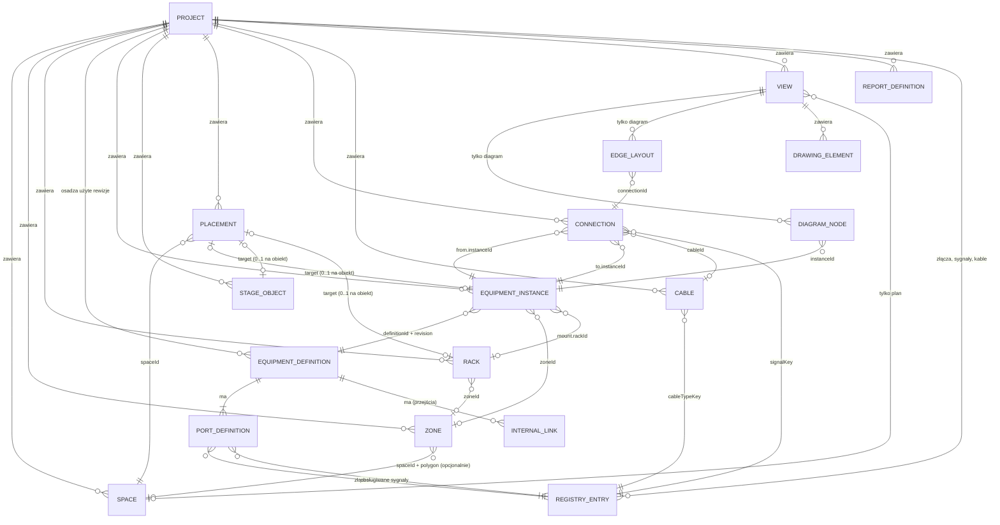
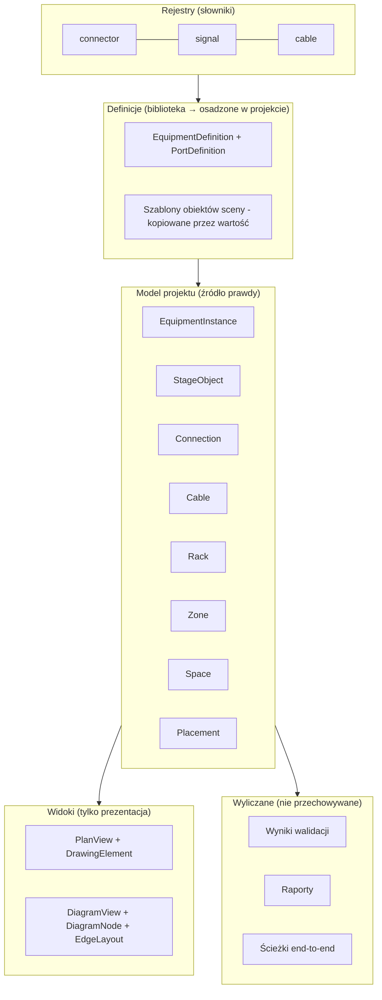

# DOMAIN-MODEL — model danych

Status: wersja 0.1 do audytu · format: `formatVersion` **1.0.0-draft** · 2026-10-31

Model jest własny i niezależny od istniejących narzędzi. Powody każdej decyzji opisują ADR w [DECISIONS.md](DECISIONS.md). Nazwy encji i pól są po angielsku. Opis po polsku.

## 1. Zasady nadrzędne

| # | Zasada | Uzasadnienie |
|---|---|---|
| Z1 | Każdy obiekt ma stabilny, niezmienny identyfikator niezależny od nazwy | ADR-003 |
| Z2 | Relacje są jawne (pole `…Id`/`PortRef`), nigdy przez nazwę | ADR-003 |
| Z3 | Fakty domenowe istnieją raz; widoki trzymają tylko prezentację | ADR-002 |
| Z4 | Model nigdy nie zawiera wiszących referencji; to niezmiennik wymuszany przez warstwę poleceń | ADR-008 |
| Z5 | Poprawność projektowa (sygnały, nakładanie U…) to walidacja wyliczana, nie stan | ADR-007 |
| Z6 | Urządzenie techniczne, obiekt sceny i element rysunku to trzy różne klasy | wymaganie projektu; ADR-009 |
| Z7 | Współrzędne są trójwymiarowe (X/Y/Z, mm) od początku, ale model 3D nie jest wymagany | ADR-009 |
| Z8 | Nieznane pola są zachowywane przy odczycie i zapisie (round-trip) | (lekcja z BIMCraft `deny_unknown_fields`) |
| Z9 | Format ma wersję i łańcuch migracji | ADR-014 |
| Z10 | Wyniki pochodne (raporty, wyniki walidacji, ścieżki end-to-end) nie są przechowywane | ADR-018 |

## 2. Mapa pojęć: lista z zamówienia a model

Wymagane było zweryfikowanie, czy wszystkie pojęcia są potrzebne w MVP.

| Pojęcie z zamówienia | Decyzja | Jak zrealizowane |
|---|---|---|
| Project | **Jest** | Korzeń, ustawienia, kolekcje |
| Sheet / View | **Jest jako `View`** | Dwa rodzaje: `plan`, `diagram`. Parametry wydruku w `View.print`; osobna encja `Sheet` poza MVP |
| Space / Venue | **Jest jako `Space`** | Pomieszczenie lub obiekt (hierarchia przez `parentId`, głębokość 2 w UI MVP) |
| Zone / Location | **Zone jest; Location rozbite** | `Zone` (obszar logiczny/przestrzenny) i `Rack`; „lokalizacja" to pole `zoneId` lub `mount`, nie osobna encja |
| Equipment Definition | **Jest** | Z rewizjami, osadzona w projekcie |
| Equipment Instance | **Jest** | Przypięta rewizja definicji |
| Port Definition | **Jest** | Część definicji, własny ID |
| Port Instance | **Nie jako encja (pojęcie wirtualne)** | Tożsamość = `PortRef {instanceId, portId}`; stan instancji w rzadkim `portOverrides` |
| Connector Type | **Jest (rejestr)** | `RegistryEntry` rodzaju `connector` |
| Signal Type | **Jest (rejestr)** | `RegistryEntry` rodzaju `signal` |
| Logical Connection | **Jest jako `Connection`** | Port ↔ port, z sygnałem |
| Physical Cable | **Jest jako `Cable`** | Opcjonalny, domyślnie 1:1 z `Connection` |
| Cable Type | **Jest (rejestr)** | `RegistryEntry` rodzaju `cable` |
| Cable Route | **Odłożone** | MVP: `lengthMm` + `lengthSource`; trasa jako waypointy tylko w diagramie. Encja `CableRoute` po MVP |
| Cabinet (szafa DIN) | **Jest** | Model i widok w prototypie (ADR-052): rzędy szyn, moduły 17,5 mm, `din` w instancji, terminale |
| Rack | **Jest** | Model i edytor elewacji w prototypie (ADR-051) |
| Rack Position | **Wartość osadzona** | `EquipmentInstance.mount` (nie encja) |
| Patch Panel | **Nie jako osobna encja** | Definicja z kategorią `patch-panel` i `internalLinks` |
| Drawing Object | **Jest jako `DrawingElement`** | Wyłącznie grafika widoku; odrębna od urządzeń |
| Document / Report | **`ReportDefinition` jest; dokument nie** | Wyniki są generowane, nie przechowywane |
| (dodane) Stage Object | **Dodane** | Fizyczne obiekty bez portów: podest, kratownica, stół… |
| (dodane) Placement | **Dodane** | Pozycja X/Y/Z i obrót w przestrzeni |

## 3. Diagram encji i relacji

Relacje do `Placement` i `PortRef` są polimorficzne (pole `targetKind` + `targetId`; para `instanceId` + `portId`). Mermaid nie wyraża tego wprost, stąd osobne linie z opisem.



### 3.1 Warstwy modelu



## 4. Identyfikatory i konwencje

| Element | Reguła |
|---|---|
| ID obiektu | Łańcuch `^[a-z]{2,5}_[0-9a-z]+$`: prefiks typu (`eqi_`, `eqd_`, `prt_`, `cnx_`, `cbl_`, `plc_`, `spc_`, `zon_`, `rck_`, `stg_`, `viw_`, `dgn_`, `drw_`, `rpt_`) + część unikalna. Generator: UUIDv7 zakodowany base32 (porządek czasowy, bez kolizji między komputerami). W przykładach używam czytelnych ID, które spełniają ten sam wzorzec |
| Niezmienność | ID nigdy się nie zmienia i nie jest ponownie używany po usunięciu |
| Klucze rejestrów | Stabilne klucze tekstowe z przestrzenią nazw: `std/hdmi-a` (wbudowane), `user/<id>` (własne) |
| Nazwy | `name`, `tag`, `label` to dane użytkownika. Unikalność nazw to **reguła walidacji**, nie tożsamość |
| Jednostki | Długości w **milimetrach**, kąty w **stopniach**, masa w kg, moc w W. Liczby JSON (float64). Wyświetlanie w innych jednostkach to ustawienie UI |
| Układ współrzędnych `Space` | Prawoskrętny: X → wschód, Y → północ, Z → w górę. Obrót CCW dodatni wokół Z. `rotationDeg = 0` oznacza front obiektu skierowany do +Y. Początek (0,0) wybiera użytkownik |
| Punkt kotwiczący `Placement` | Środek obrysu obiektu w płaszczyźnie XY; `z` to rzędna **podstawy** obiektu względem podłogi `Space` |
| Układ współrzędnych diagramu | Osobny: jednostki diagramu, Y w dół. Nigdy nie mieszany z mm planu |
| Znaczniki czasu | ISO 8601 UTC |
| Nieznane pola | Zachowywane. Zarezerwowane pole `ext` (obiekt przestrzeni nazw) na dane rozszerzeń |

## 5. Encje szczegółowo

W kolumnie „MVP" **M** = używane w MVP, **R** = pole zarezerwowane w modelu (puste w MVP).

### 5.1 Project

| Pole | Typ | MVP | Opis |
|---|---|---|---|
| `formatVersion` | semver | M | Wersja formatu (§10) |
| `id`, `name` | string | M | |
| `meta` | `{client, venue, eventDates[], author, notes, createdAt, modifiedAt}` | M | Informacje do tabliczki dokumentów |
| `settings` | obiekt | M | `defaultCableSlackMm`, `stockCableLengthsMm[]`, `cableNumbering`, `validationOverrides`, `units`, `locale`, `grid` |
| `registries` | mapa `key → RegistryEntry` | M | Tylko użyte i własne wpisy (reszta z biblioteki wbudowanej) |
| `definitions` | mapa `definitionId → {latestRevision, revisions: {n → EquipmentDefinition}}` | M | Przypięte rewizje + najnowsza (przenośność), §5.3 |
| `spaces`, `zones`, `racks` | mapy `id → obiekt` | M (racks: M model, edytor później) | |
| `equipment`, `stageObjects` | mapy `id → obiekt` | M | |
| `placements` | mapa `id → obiekt` | M | |
| `connections`, `cables` | mapy `id → obiekt` | M | |
| `views` | mapa `id → obiekt` | M | |
| `reportDefinitions` | mapa `id → obiekt` | M (tylko zapisane szablony) | |
| `suppressions` | `{ruleId, subject, reason, by, at}[]` | M | Odrzucone ostrzeżenia (jak odrzucanie w palecie statusu narzędzi CAD) |
| `packing` | `{rows: {rowKey → packedCount}, extras: [{id, text, packed}]}` | M | Stan packlisty jako **dane użytkownika**. Klucz wiersza: sprzęt `eq:<definitionId>:<supply>` (rewizja pomijana: fizycznie to ten sam produkt), obiekty sceny `so:<kind>:<widthMm>x<depthMm>x<heightMm>`, kable `cb:<cableTypeKey>:<stockLengthMm>` (dla przydzielonej długości) lub `cb:<cableTypeKey>:sugg<mm>` (dla propozycji; przejście propozycja→przydział zmienia klucz i zeruje licznik). Lista pozycji pozostaje wyliczana (Z10), zapisywany jest tylko postęp i „extras" (wzorzec inne narzędzia). **Reguła spójności:** przy każdej zmianie liczby w wierszu zapisany licznik jest **trwale przycinany** do `min(packedCount, nowa liczba)` (nie tylko przy wyświetlaniu), więc 5 spakowanych → liczba 3 → liczba 5 daje 3 z 5, a nie 5 z 5; wiersz jest spakowany tylko gdy `packedCount == liczba`; zmiana `supply` lub `stockLengthMm` zmienia klucz i zaczyna od 0; osierocone klucze są usuwane przy zapisie |
| `ext` | obiekt | R | Dane rozszerzeń |

W pliku i w pamięci kolekcje encji są **mapami `Record<ID, T>`**, a nie tablicami (kolejność nie niesie znaczenia, prostsze scalanie i sync w przyszłości, ADR-022). Kolejność, gdzie ma znaczenie (np. porty), jest jawnym polem `order`. **Dozwolone tablice** (wartości bez własnej tożsamości lub z kolejnością niosącą znaczenie; lista jest wyczerpująca dla wersji 1.0.0-draft, a każda nowa tablica wymaga wpisu tutaj): `meta.eventDates`, `settings.stockCableLengthsMm`, `signalKeys`, `tags`, `endPairs`, `carriesSignals`, `internalLinks`, `suppressions`, `packing.extras`, `waypoints`, `ReportDefinition.columns`/`groupBy`/`sortBy`, `hiddenConnections`, `boundary`/`polygon`/`footprint.points`. Tabele w §5 opisują pola, nie kształt kolekcji. Decyzja Q-12 jest rozstrzygnięta (mapy), warunkowo do pomiarów PoC-1.

#### Identyfikatory: klucz mapy czy pole (decyzja wykonawcza S-01)

**Normatywny jest format dyskowy:** identyfikator obiektu jest **kluczem mapy** i nie jest powtarzany w obiekcie. Dotyczy to: `definitions[definitionId]`, `revisions[n]` (numer rewizji = klucz, zapisany jako ciąg), `ports[portId]`, `registries[key]` (`RegistryEntry.key` to wyłącznie klucz mapy), wszystkich kolekcji encji, `nodes`, `edgeLayouts` (klucz = `connectionId`). Kolumny `id`, `revision` i `key` w tabelach §5 opisują **logiczne pola modelu w pamięci**, które warstwa odczytu uzupełnia z kluczy; JSON Schema dla pliku **nie zawiera** tych pól i akceptuje przykład z §12 w obecnym kształcie. Nie dodajemy redundantnych pól wyłącznie dla walidatora. Zapis z pola `id` niezgodnego z kluczem (np. w pliku z zewnątrz) jest błędem walidacji schematu.

### 5.2 RegistryEntry (Connector Type, Signal Type, Cable Type)

Jeden mechanizm, trzy rodzaje (`kind`). Rozstrzyga niespójność trzech taksonomii.

| Pole | Dotyczy | Opis |
|---|---|---|
| `key` | wszystkie | `std/…` lub `user/…`; stabilny |
| `kind` | wszystkie | `connector` \| `signal` \| `cable` |
| `name`, `shortName` | wszystkie | Np. „HDMI typ A", „HDMI" |
| `domain` | signal, cable | `video`, `audio`, `network`, `control`, `power`, `lighting`, `data`, `other` (zbiór otwarty) |
| `color` | signal, cable | Kolor linii na diagramie (wg sygnału) |
| `lineStyle` | signal | `solid` \| `dashed` \| `dotted` |
| `family` | connector | Opcjonalna rodzina (np. `bnc`, `rj45`) do grupowania w UI; **nie** służy do orzekania o zgodności |
| `gender` | connector | `male` \| `female` \| `neutral` — **R** (rezerwa). W MVP płeć jest zakodowana w kluczu złącza *portu* (port urządzenia to „gniazdo"), a kabel opisuje, w co się wpina |
| `carriesSignals` | connector, cable | Sygnały, które typowo niesie (podpowiedź dla złącza: RJ45 niesie wiele; **dla kabla** używane przez V-013) |
| `endPairs` | cable | **M.** Lista par `[connA, connB]`: klucze złączy *portów*, w które wpinają się dwa końce kabla (kolejność nieistotna). Np. koncentryk BNC: `[["std/bnc-75","std/bnc-75"]]`; przewód z przejściem HDMI↔DVI: `[["std/hdmi-a","std/dvi-d"]]`. Zgodność fizyczna = istnieje typ kabla, którego `endPairs` pokrywa parę złączy obu portów (poprawka audytu P0-02: nie ma „bezpośredniego łączenia port-port") |
| `maxLengthMm` | cable | Opcjonalny limit do walidacji; wartość pochodzi z pakietu biblioteki ze źródłem |
| `prefix` | signal/cable | Prefiks numeracji (np. `V`, `A`, `N`) |
| `origin` | wszystkie | Pochodzenie i licencja wpisu |

### 5.3 EquipmentDefinition

| Pole | Typ | MVP | Opis |
|---|---|---|---|
| `id` | `eqd_…` | M | Stabilny ID definicji (wspólny dla rewizji) — klucz w `definitions` |
| `revision` | int ≥ 1 | M | Numer rewizji — klucz w `definitions[id].revisions`. **Rewizja jest niemutowalna** (patrz reguła poniżej) |
| `key` | string? | M | Odnośnik do biblioteki: `packId/defKey` |
| `manufacturer`, `model` | string | M | Producent/model (do normalizacji, G8) |
| `category` | string + `tags[]` | M | Zbiór otwarty (`camera`, `switcher`, `audio-console`, `network-switch`, `patch-panel`, `display`, `speaker`…). Kategoria ≠ sygnał |
| `kind` | `physical` \| `virtual` | M | Wirtualne: bez wymiarów, np. „Internet", „Chmura streamingu" |
| `dimensionsMm` | `{width, depth, height}?` | M | Obrys do planu; wymagany tylko gdy `physical` i ma być umieszczone |
| `rackUnits` | `{heightU, widthFraction: 1 \| 0.5 \| 0.33}?` | M | |
| `weightKg`, `powerW` | number? | M | Opcjonalne |
| `ports` | mapa `portId → PortDefinition` (kolejność: pole `order`) | M | Patrz 5.4 |
| `internalLinks` | `InternalLink[]` | R→M(Should) | Przejścia wewnętrzne (patchpanel, loop-through) |
| `symbol` | `{icon, color}` | M | Wygląd w widokach |
| `origin` | `{packId, packVersion, license, source, derivedFromRevision?}` | M | Pochodzenie danych; `custom: true` dla własnych |
| `notes` | string | M | |

#### Normatywny magazyn rewizji (poprawka audytu P0-01)

```
definitions[definitionId] = { latestRevision: N, revisions: { "1": {…}, "2": {…} } }
```

1. **Rewizja jest niemutowalna.** *Każda* edycja definicji (także zmiana etykiety portu, notatki, ikony) tworzy nową rewizję `N+1` jako kopię z zachowaniem `id` portów. Dzięki temu projekt nigdy nie traci odtwarzalności: instancja przypięta do rewizji 1 zawsze widzi dokładnie jej porty.
2. **Edycje kosmetyczne** (etykieta, grupa, notatka, ikona, wymiary) są oznaczone w rewizji `changeClass: "cosmetic"`; aplikacja oferuje „zaktualizuj wszystkie instancje do N+1" jednym kliknięciem bez listy skutków (żaden `PortRef` się nie zmienia). Zmiana strukturalna (`changeClass: "structural"`: dodanie/usunięcie portu, zmiana złącza, sygnałów lub kierunku) wymaga ekranu skutków przy upgrade.
3. **Co jest osadzone w pliku:** każda rewizja przypięta przez co najmniej jedną instancję **oraz** rewizja `latestRevision`. Nieprzypięte starsze rewizje są pomijane **wyłącznie przy serializacji** (widok pliku); model w pamięci zachowuje wszystkie rewizje potrzebne historii cofania w bieżącej sesji, więc „upgrade → zapis → cofnij" działa bez zamykania (test w PoC-1). Użytkownik może oznaczyć rewizję jako „zachowaj".
4. **Upgrade instancji** `rev A → rev B` jest jedną transakcją: dla portów obecnych w obu rewizjach `PortRef` pozostaje bez zmian; dla portów usuniętych połączenia są listowane i użytkownik wybiera „usuń połączenia" albo „anuluj". Cofnięcie przywraca przypięcie do A.
5. **Fork** (kopia lokalna): nowe `definitionId`, `origin.derivedFrom = {definitionId, revision}`, rewizja 1; instancje można przepiąć świadomą operacją.
6. **Import paczki** nigdy nie nadpisuje istniejącej rewizji; jeśli paczka zawiera definicję o tym samym `key` i innej treści, powstaje nowa rewizja (lub konflikt do rozstrzygnięcia przy imporcie).
7. **Usunięcie portu** istnieje wyłącznie jako utworzenie nowej rewizji bez tego portu; nigdy jako zmiana rewizji przypiętej.
8. **Wycofanie rewizji:** niemożliwe, gdy jest przypięta; po przepięciu wszystkich instancji rewizja znika przy porządkowaniu.

**Test akceptacji (fixture):** instancja A przypięta do rew. 1, instancja B do rew. 2 tej samej definicji (różne zestawy portów), połączenia do obu; zapis → odczyt → cofnięcie → import paczki nie zmieniają żadnego `PortRef`.

### 5.4 PortDefinition

| Pole | Typ | MVP | Opis |
|---|---|---|---|
| `id` | `prt_…` | M | Stabilny w ramach definicji, nigdy nie używany ponownie. **Zmiana etykiety nie zmienia ID** |
| `label` | string | M | Np. „SDI IN 1" |
| `group` | string? | M | Grupa (np. „SDI IN") — do zwijania/układu |
| `order` | int | M | Kolejność |
| `connectorKey` | klucz rejestru | M | **Oś 1: złącze fizyczne** |
| `signalKeys` | klucze rejestru (≥1) | M | **Oś 2: sygnały obsługiwane**; port może obsługiwać wiele (RJ45: ethernet, Dante…). Rzeczywisty sygnał ustala `Connection.signalKey` |
| `direction` | `in` \| `out` \| `io` \| `loop` | M | **Oś 3: kierunek** (`loop` = wyjście przelotowe) |
| `side` | `left` \| `right` \| `top` \| `bottom` \| `auto` | M | Domyślnie `auto`: in → lewo, out → prawo |
| `capacity` | int ≥ 1 (domyślnie 1) | M | Maks. liczba połączeń na porcie; przekroczenie = błąd walidacji |
| `gender` | `male` \| `female` \| `neutral` | R | |
| `channels` | int? | R | Liczba kanałów (np. 8 dla multipinu) |
| `notes` | string | M | |

Krotność znana z narzędzi CAD („Qty") nie jest polem modelu: edytor definicji **generuje N osobnych `PortDefinition`** (UX „szybkie porty"). Model pozostaje płaski i prosty.

### 5.5 InternalLink (R→M, Should)

| Pole | Opis |
|---|---|
| `a`, `b` | `portId` w tej samej definicji |
| `kind` | `passthrough` (patchpanel: front↔tył), `loopthrough` (wejście → wyjście przelotowe) |
| `bidirectional` | bool |

Służy do **wyprowadzania ścieżek end-to-end** przez patchpanele bez rozcinania połączenia na dwa obwody, jak w narzędziach CAD.

### 5.6 EquipmentInstance

| Pole | Typ | MVP | Opis |
|---|---|---|---|
| `id` | `eqi_…` | M | |
| `definitionId`, `definitionRevision` | | M | **Przypięcie rewizji**; upgrade jest jawną operacją |
| `name` | string | M | Np. `CAM1` (automatyczna numeracja przy dodawaniu) |
| `tag` | string? | M | Krótka etykieta wyświetlana |
| `zoneId` | `zon_…`? | M | Jawna relacja strefy (ADR-011) |
| `mount` | `{rackId, uStart, face: front\|rear, slot: full\|left\|center\|right}?` | M model + UI w prototypie (ADR-051) | Pozycja w racku jako wartość osadzona; `center` tylko dla urządzeń 1/3 szerokości |
| `supply` | `owned` \| `rental` \| `client` \| `unknown` | M | Przydatne do packlisty |
| `portOverrides` | mapa `portId → {label?, notes?, attrs?}` | M | Rzadkie dane per port; `attrs` = swobodne pary klucz/tekst (IP, VLAN, nazwa kanału — G4) |
| `notes` | string | M | |
| `ext` | | R | |

**Instancja nie ma własnej listy portów.** Aby zmienić strukturę portów, użytkownik **tworzy lokalną kopię definicji** (`derivedFrom`) i przepina instancje. Zapobiega rozjazdowi struktury instancji względem definicji (problem inne narzędzia „pełna kopia" i inne narzędzia „definicja w symbolu").

### 5.7 StageObject

Fizyczne obiekty bez portów sygnałowych: podest, kratownica, stół, krzesło, ekran projekcyjny, zasłona, element scenografii.

| Pole | Opis |
|---|---|
| `id`, `name`, `tag`, `notes`, `zoneId` | Jak w instancji |
| `kind` | `platform` \| `truss` \| `table` \| `chair` \| `screen-surface` \| `scenery` \| `barrier` \| `generic` (zbiór otwarty) |
| `footprint` | `{shape: rect\|circle\|polygon, widthMm, depthMm \| radiusMm \| points[]}` |
| `heightMm` | Wysokość obiektu |
| `weightKg?`, `color?` | |
| `definitionKey?` | Wyłącznie **pochodzenie** (z jakiego szablonu biblioteki powstał, np. „podest 2×1 m"). Poprawka audytu P2: w MVP **nie ma `StageObjectDefinition`, rewizji ani wersjonowania** — szablon jest kopiowany przez wartość do obiektu przy wstawianiu; późniejsza zmiana szablonu nie dotyka istniejących obiektów |

**Zakres:** `StageObject` jest **obrysem koncepcyjnym**, nie kompletnym zestawem montażowym: podest 8×4 m to jedna sztuka na planie i w raporcie, bez liczby modułów, nóg i łączników. Użytkownik, który potrzebuje modułów, wstawia je jako osobne `StageObject` (np. 16 × 2×1 m); automatyczne dzielenie na moduły jest poza MVP.

`StageObject` nie ma `PortRef`, więc nie może wystąpić w `Connection`. To wymusza rozdział pojęć wymagany w zamówieniu. Ekran LED z wejściami wideo jest **EquipmentInstance** (ma porty), a nie StageObject.

### 5.8 Placement (położenie w przestrzeni)

| Pole | Opis |
|---|---|
| `id`, `spaceId` | |
| `targetKind` | `equipment` \| `stageObject` \| `rack` |
| `targetId` | ID obiektu; **unikalne**: obiekt ma co najwyżej jedno `Placement` (fizycznie stoi w jednym miejscu) |
| `position` | `{x, y, z}` mm |
| `rotationDeg` | wokół Z |
| `orientation` | kwaternion — **R** (pełna orientacja 3D po MVP) |
| `locked` | bool |

Brak `Placement` jest dozwolony (urządzenie wirtualne, „jeszcze nie rozstawione"; walidacja informacyjna V-020).

### 5.9 Space i Zone

**Space**: `id`, `name`, `parentId?` (obiekt → sala), `boundary` (wielokąt `[[x,y],…]` mm), `floorElevationMm`, `ceilingHeightMm?`, `notes`.

**Zone**: obszar logiczny, np. FOH, SCENA, REŻYSERKA, MAGAZYN. `id`, `name`, `color`, opcjonalnie `spaceId` + `polygon`. Strefa bez geometrii jest dozwolona (np. „Wóz transmisyjny"). Przypisanie obiektu do strefy to jawne pole `zoneId`. Edytor planu **podpowiada** strefę, gdy obiekt zostanie upuszczony w jej wielokącie; walidacja V-016 ostrzega o niezgodności.

### 5.10 Rack

`id`, `name`, `units` (np. 42), `widthIn` (19), `depthMm`, `zoneId?`, `notes`. Rack ma `Placement` (stoi w sali). Zawartość racka to instancje z `mount.rackId`; w MVP nie mają własnych `Placement` (położenie wynika z racka). Przesunięcie racka nie wymaga aktualizacji zawartości, bo zawartość nie ma współrzędnych [W-10: odpowiednik propagacji inne narzędzia uzyskany strukturalnie].

### 5.11 Connection (połączenie logiczne)

| Pole | Typ | MVP | Opis |
|---|---|---|---|
| `id` | `cnx_…` | M | |
| `from`, `to` | `PortRef {instanceId, portId}` | M | `from` = źródło (out/io/loop), `to` = odbiornik |
| `signalKey` | klucz rejestru | M | Faktyczny sygnał na tym połączeniu |
| `medium` | `physical` \| `wireless` \| `virtual` | M | **Poprawka audytu P0-03.** Jednoznacznie odróżnia połączenie bezprzewodowe/logiczne od fizycznego. Domyślnie `physical` |
| `cableId` | `cbl_…`? | M | Dla `physical` zwykle ustawione. `cableId = null` przy `medium = physical` oznacza **kabel nieprzypisany** (np. po usunięciu kabla) i zgłasza V-019; przy `wireless`/`virtual` `cableId` musi być `null` i nie zgłasza nic |
| `label`, `notes` | | M | |
| `attrs` | mapa tekstowa | M | Np. VLAN, kanał |
| `ext` | | R | |

Niezmienniki: `from.portId` i `to.portId` istnieją w przypiętej rewizji definicji; `from ≠ to`; oba końce wskazują istniejące instancje. Kierunek i zgodność sygnałów to **walidacja**, nie niezmiennik (ADR-007).

### 5.12 Cable (kabel fizyczny)

| Pole | Opis |
|---|---|
| `id`, `cableTypeKey` | Typ z rejestru |
| `number` | Etykieta/numer kabla (np. `V001`); unikalność jako reguła walidacji V-004 |
| `lengthMm?` | **Wymagana długość projektowa** (ile kabla trzeba na trasę), nie długość konkretnego przewodu z magazynu |
| `stockLengthMm?` | **Przydzielona długość przewodu** wybrana do packlisty (np. gotowy patchcord 15 m albo kabel przycięty na wymiar). Dowolna wartość > 0, niekoniecznie z `stockCableLengthsMm`. Gdy `stockLengthMm < lengthMm`, walidator zgłasza V-026 (przydział krótszy od wymaganej trasy); stan nie jest zabroniony. Gdy brak, packlista pokazuje **propozycję** wyliczoną z `lengthMm` i `stockCableLengthsMm` (zaokrąglenie w górę), jawnie oznaczoną jako „propozycja do weryfikacji", nie pewną ilość sprzętu |
| `lengthSource` | `manual` \| `estimated` \| `unknown` (a później `computed` z sieci tras). `estimated` to **szacunek do zamówienia**, nie zweryfikowana długość montażowa |
| `estimateBasis?` | `{geometryHash, slackMm, at}` — odcisk współrzędnych obu końców i parametrów użytych do szacunku. Gdy bieżący odcisk różni się od zapisanego, długość jest **nieaktualna** (`stale`, wyliczane; V-025). Tylko przy `lengthSource = estimated` |
| `color?`, `notes` | |
| `ext` | |

Kabel **nie ma własnych końców**; końce wynikają z połączeń, które na niego wskazują. Współdzielony `cableId` pozwala wielu `Connection` wskazywać jeden kabel, ale **nie modeluje** fizycznej wiązki (końców, przejściówek, fanoutów); multicore w v1.0 wymaga osobnego projektu. W MVP UI tworzy relację 1:1 (ADR-006).

### 5.13 View, DiagramNode, EdgeLayout, DrawingElement

**View**: `id`, `kind` (`plan` \| `diagram`), `name`, `viewport {x, y, zoom}`, `layers` (widoczność kategorii), `print {paper, orientation, scale, titleBlock}`, `grid {sizeMm, snap, style}`; dla `plan`: `spaceId`, `underlay?`; dla `diagram`: `nodes`, `edgeLayouts`, `hiddenConnections[]`.

**DiagramNode**: `id`, `instanceId`, `x`, `y`, `collapsed?`, `portSideOverrides?`. Co najwyżej jeden węzeł danej instancji na widok; dowolnie wiele widoków.

**EdgeLayout**: `connectionId`, `waypoints[]`. Istnienie krawędzi na diagramie jest **pochodne**: krawędź jest rysowana, gdy oba końce mają węzeł w widoku, a połączenie nie jest w `hiddenConnections`. Dzięki temu nie ma wiszących krawędzi i nie trzeba synchronizować „linii" z modelem (ADR-010).

**DrawingElement** (należy do `View`): `kind` (`line`, `polyline`, `rect`, `ellipse`, `polygon`, `text`, `dimension`, `note`, `image`), geometria, styl (`color`, `weight`, `dash`), `locked`. **Nie jest** urządzeniem ani obiektem sceny, więc nie pojawia się w raportach sprzętu. Wymiar (`dimension`) w MVP jest prostym obiektem z dwoma punktami; wartość liczona z geometrii.

### 5.14 ReportDefinition

`id`, `builtinKey` (np. `equipment-list`), `name`, `columns[]`, `groupBy[]`, `sortBy[]`, `filter`. Zapisywane są tylko szablony zmodyfikowane przez użytkownika. Wyniki nie są przechowywane (Z10).

## 6. Reguły integralności referencyjnej (kluczowe)

Tabela rozstrzyga niespójności zaobserwowane w narzędziach CAD i brak odpowiedników w narzędziach webowych.

| Operacja | Skutek | Potwierdzenie | Cofanie |
|---|---|---|---|
| Zmiana etykiety portu / nazwy urządzenia | **Nic** nie zmienia się w relacjach | — | 1 krok |
| Usunięcie `EquipmentInstance` | Usuwa jego `Connection` i `DiagramNode`, `Placement`; `Cable` bez pozostałych połączeń również usuwany (kaskada) | **Tak**, jeśli kaskada obejmuje ≥1 połączenie: lista skutków | 1 krok |
| „Usuń z widoku" (diagram/plan) | Usuwa tylko `DiagramNode` / grafikę. Model bez zmian | Nie | 1 krok |
| Usunięcie `Connection` | Usuwa `EdgeLayout`; `Cable` usuwany, jeśli osierocony | Nie | 1 krok |
| Usunięcie `Cable` | `Connection.cableId = null`, `medium` bez zmian (fizyczne połączenie staje się „kabel nieprzypisany", V-019) | Nie | 1 krok |
| Nowa rewizja definicji bez portu P | Instancje przypięte do starej rewizji **nie zmieniają się** | — | — |
| Upgrade instancji do rewizji bez portu P | Połączenia z P: lista; w Core [M] wybór „usuń powiązane połączenia" lub „anuluj" (bez mapowania stary→nowy port). „Przepnij" dopiero z F-19 [S] | **Tak**, z listą | 1 krok |
| Usunięcie `Zone` | `zoneId` instancji ustawione na `null` | Gdy zawiera obiekty | 1 krok |
| Usunięcie `Rack` | `mount` zawartości ustawione na `null` | Tak | 1 krok |
| Usunięcie `Space` | Zablokowane, dopóki ma `Placement`, albo jawna kaskada | Tak | 1 krok |
| Usunięcie definicji z projektu | Dozwolone tylko, gdy nic jej nie używa | — | — |

**Niezmiennik strukturalny:** po każdej transakcji spełnione jest: (1) każde pole `…Id` wskazuje istniejący obiekt; (2) każdy `PortRef` wskazuje istniejący port w przypiętej rewizji; (3) ID są unikalne. Naruszenie w testach własności = błąd krytyczny.

## 7. Walidacja (miękka) — katalog reguł MVP

Poziomy: `error`, `warning`, `info`. Każdy poziom reguły można zmienić lub wyłączyć w `settings.validationOverrides`. Reguła ma ID, powód i, jeśli możliwe, „szybką naprawę". Wynik jest wyliczany i nie jest zapisywany.

| ID | Domyślny poziom | Reguła | Szybka naprawa |
|---|---|---|---|
| V-001 | error | Kierunek niezgodny (out→out, in→in), poza `io`/`loop` | **Wskaż inny port docelowy** (lista portów zgodnych kierunkiem). „Zamień końce" jest oferowane tylko dla pary in→out zapisanej odwrotnie; dla out→out i in→in brak automatycznej naprawy (poprawka audytu P1-09) |
| V-002 | error | Przekroczona `capacity` portu | Wskaż nadmiarowe |
| V-003 | error | Nakładanie się zakresów U w racku (ta sama strona i slot) | Przesuń do wolnej pozycji |
| V-004 | error | Duplikat `Cable.number` | Numeruj ponownie |
| V-010 | warning | Brak wspólnego sygnału w portach i `Connection.signalKey` poza zbiorem sygnałów któregoś portu | Wybierz dozwolony sygnał |
| V-011 | warning / info | **Uruchamiana wyłącznie dla `medium = physical` z przypisanym `Cable`** (fizyczny bez kabla zgłasza tylko V-019; `wireless`/`virtual` nie zgłaszają V-011/V-013/V-019). **Wynik trójwartościowy** (poprawka audytu P0-02). Kabel `Cable` połączenia ma `endPairs` pokrywające parę złączy obu portów → zgodne (brak wpisu). Kabel ma `endPairs`, ale żadna para nie pasuje → *warning* „kabel X nie wpina się w te porty (A ↔ B)". Kabel bez `endPairs` → *info* „zgodności złączy nie da się ocenić". Reguła **nie twierdzi**, że potrzebny jest adapter; może to jedynie zasugerować, gdy `endPairs` zawiera parę zawierającą jeden z kluczy | Zmień typ kabla; dodaj konwerter/adapter jako urządzenie |
| V-012 | warning | Duplikat `EquipmentInstance.name` | Zmień nazwę |
| V-013 | warning / info | Tylko dla `medium = physical` z przypisanym `Cable`. Typ kabla ma `carriesSignals`, które nie zawiera `Connection.signalKey` → warning; brak `carriesSignals` → info „nie da się ocenić" | Zmień typ |
| V-026 | warning | `stockLengthMm < lengthMm` (przydzielony przewód krótszy niż wymagana trasa). Raport kabli i packlista oznaczają taki wiersz; brak ostrzeżenia dla `stockLengthMm ≥ lengthMm`. Reguła planowana na M5, w PoC-1 tylko fixture (`12000/10000` → ostrzeżenie; `12000/15000`, `12000/20000` → brak) | Zwiększ przydział lub zmień wymaganą długość |
| V-019 | warning | `medium = physical` bez kabla (kabel nieprzypisany) | Utwórz/przypisz kabel |
| V-025 | info | Długość `estimated` nieaktualna (zmieniły się współrzędne lub zapasy) albo estymata niemożliwa (końce w różnych `Space`) | Przelicz |
| V-015 | warning | `Placement` poza granicą `Space` | Przesuń |
| V-016 | warning | Obiekt poza obszarem swojej strefy | Zmień strefę |
| V-017 | warning | Długość kabla > `maxLengthMm` typu | Zmień typ/trasę |
| V-018 | warning | Brak długości przy włączonej polityce „wymagaj długości" | Oszacuj |
| V-020 | info | Urządzenie fizyczne bez `Placement` | Umieść |
| V-021 | info | Instancja nie występuje na żadnym diagramie | Dodaj do diagramu |
| V-022 | info | Port wejściowy bez połączenia (konfigurowalne) | — |
| V-023 | info | Dostępna nowsza rewizja definicji | Pokaż zmiany |
| V-024 | info | Definicja zmodyfikowana lokalnie względem biblioteki | — |

Reguły są **danymi z kodem** w module `@core/validation`; użytkownik może zmieniać poziomy, a w przyszłości dodawać własne.

## 8. Wyprowadzane wartości (nieprzechowywane)

| Wartość | Sposób wyliczenia |
|---|---|
| `connectionsOf(portRef)` | indeks po `from`/`to` |
| Ścieżka end-to-end | przejście grafem: połączenia + `InternalLink` |
| Efektywna strefa | `zoneId` ?? `rack.zoneId` |
| Pozycja efektywna (`effectivePosition`) | Poprawka audytu P1-08. (a) Obiekt z `Placement`: jego `position`. (b) Urządzenie z `mount` w racku: XY racka, `z = rack.z + (uStart − 1) × 44,45 mm` (jednostka U), obrót racka; używane przez raporty i estymatę. (c) Obiekt stojący na podeście: `z` jest **jawnie zapisane**; edytor jedynie *podpowiada* górną powierzchnię podestu pod obiektem (nie jest to automat). (d) Brak `Placement` i `mount` → pozycja nieznana |
| Estymata długości | Manhattan między `effectivePosition` obu końców w XY + \|ΔZ\| + `defaultCableSlackMm` × 2, zaokrąglona do `stockCableLengthsMm` w raporcie. **Tylko gdy oba końce są w tej samej `Space`**; między różnymi `Space` brak wspólnego układu współrzędnych, więc estymata jest odmawiana (V-025), a długość wpisuje się ręcznie. Wyliczana poleceniem „Oszacuj długości"; wynik zapisuje się do `Cable.lengthMm` z `lengthSource = estimated` i `estimateBasis` **tylko na polecenie użytkownika** (nie nadpisuje `manual`). Po zmianie geometrii wartość pozostaje, ale jest oznaczana jako nieaktualna |
| Pozycje krawędzi diagramu | trasowanie ortogonalne + `waypoints` |
| Raporty | zapytania nad modelem (ADR-018) |

## 9. Rozdzielenie danych domenowych i widoków (podsumowanie)

| Należy do modelu | Należy do widoku |
|---|---|
| Instancje, definicje, porty, połączenia, kable | Pozycje `DiagramNode`, `waypoints` |
| `Placement` (X/Y/Z, obrót) | Viewport, siatka, widoczność warstw |
| Strefy, racki, przestrzenie | `DrawingElement` (linie, wymiary, teksty, tło planu) |
| Rejestry, ustawienia projektu | Parametry wydruku (papier, skala, tabliczka) |

## 10. Wersjonowanie formatu i migracje

- `formatVersion` w `manifest.json` i `project.json`: **semver**. Zmiana MAJOR = niezgodna, MINOR = zgodna wstecz (nowe pola opcjonalne), PATCH = poprawki.
- Migracje to **czyste funkcje** `migrate_vN_to_vN+1(json) → json`, testowane na plikach wzorcowych (fixtures) każdej wersji. Plik z nowszym MAJOR: pokaż metadane z `manifest.json` i ostrzeżenie; **nie zapisuj ani nie migruj**. Podgląd treści tylko jeśli plik da się sparsować schematem znanej wersji; w przeciwnym razie wyłącznie metadane (poprawka audytu P1-07).
- Zachowanie nieznanych pól i `ext` (Z8) przy zgodnym MINOR. Test: plik z dodatkowymi polami po odczycie i zapisie ma je nadal. Zachowanie pola **nie oznacza zrozumienia** nowszej semantyki; aplikacja ostrzega, że plik zawiera nieznane pola.
- **Format na dysku vs wewnętrzny (P1-01):** kolekcje encji, `ports`, `revisions`, `nodes`, `edgeLayouts` są **mapami kluczowanymi ID** zarówno na dysku, jak i w pamięci; kolejność wyświetlania niosą jawne pola `order`. Tabele w §5 opisują pola obiektów, nie kształt kolekcji. Normatywny jest schemat JSON Schema (pierwszy produkt PoC-1, przed fixturami).
- Kanoniczna serializacja: posortowane klucze, stałe wcięcia, LF. Daje porównywalne diffy i hash do wykrywania zmian.
- Schemat normatywny: JSON Schema (draft 2020-12) publikowany razem ze specyfikacją formatu (ADR-014).

## 11. Wymagania architektoniczne a model (lista kontrolna)

| Wymaganie | Spełnienie |
|---|---|
| Stabilne identyfikatory | §4, Z1 |
| Jawne relacje | Z2, §6 |
| Wersjonowany format, migracje | §10 |
| Spójność referencyjna | §6, niezmiennik strukturalny |
| Cofanie/ponawianie | Polecenia i transakcje w warstwie poleceń (ARCHITECTURE §4); model wspiera inwersję przez łaty |
| Rozdzielenie domeny od diagramu | §5.13, §9 |
| Przyszły eksport do innych systemów | Płaski, jednoznaczny graf z ID; wzorce eksportu w ARCHITECTURE §11 |
| Brak wymogu modelu 3D | `Placement` opcjonalny, `z` liczbą; brak geometrii 3D |
| X/Y/Z i orientacja od początku | §5.8, `orientation` zarezerwowane |

## 12. Przykładowy projekt (mały)

Dane **ilustracyjne**: producent „Generic", parametry nie odpowiadają żadnemu realnemu produktowi i nie są weryfikowane. Pokazuje 1 salę, scenę, 2 kamery, mikser wideo, ekran LED, przełącznik sieciowy, 5 połączeń, plan i diagram. Skrócono rejestry do użytych wpisów.

```json
{
  "formatVersion": "1.0.0-draft",
  "id": "prj_demo1",
  "name": "Konferencja — przykład minimalny",
  "meta": {
    "client": "Klient Demo",
    "venue": "Hala A",
    "eventDates": [
      "2026-11-20"
    ],
    "author": "A. Technik",
    "notes": "",
    "createdAt": "2026-10-31T10:00:00Z",
    "modifiedAt": "2026-10-31T10:30:00Z"
  },
  "settings": {
    "defaultCableSlackMm": 1000,
    "stockCableLengthsMm": [
      1000,
      2000,
      3000,
      5000,
      10000,
      15000,
      20000,
      30000
    ],
    "cableNumbering": {
      "pattern": "{prefix}{seq:3}"
    },
    "validationOverrides": {},
    "units": "mm",
    "locale": "pl"
  },
  "registries": {
    "std/bnc-75": {
      "kind": "connector",
      "name": "BNC 75 Ω"
    },
    "std/hdmi-a": {
      "kind": "connector",
      "name": "HDMI typ A"
    },
    "std/rj45": {
      "kind": "connector",
      "name": "RJ45"
    },
    "std/sdi-3g": {
      "kind": "signal",
      "name": "SDI 3G",
      "domain": "video",
      "color": "#2f7fd1",
      "prefix": "V"
    },
    "std/hdmi": {
      "kind": "signal",
      "name": "HDMI",
      "domain": "video",
      "color": "#6b6b6b",
      "prefix": "V"
    },
    "std/ethernet": {
      "kind": "signal",
      "name": "Ethernet",
      "domain": "network",
      "color": "#2fa84f",
      "prefix": "N"
    },
    "std/cable-sdi": {
      "kind": "cable",
      "name": "Koncentryk SDI",
      "endPairs": [
        [
          "std/bnc-75",
          "std/bnc-75"
        ]
      ],
      "carriesSignals": [
        "std/sdi-3g"
      ]
    },
    "std/cable-hdmi": {
      "kind": "cable",
      "name": "Kabel HDMI",
      "endPairs": [
        [
          "std/hdmi-a",
          "std/hdmi-a"
        ]
      ],
      "carriesSignals": [
        "std/hdmi"
      ]
    },
    "std/cable-cat6": {
      "kind": "cable",
      "name": "Kabel Cat6",
      "endPairs": [
        [
          "std/rj45",
          "std/rj45"
        ]
      ],
      "carriesSignals": [
        "std/ethernet"
      ]
    }
  },
  "definitions": {
    "eqd_cam": {
      "latestRevision": 1,
      "revisions": {
        "1": {
          "manufacturer": "Generic",
          "model": "Camera SDI",
          "category": "camera",
          "kind": "physical",
          "dimensionsMm": {
            "width": 300,
            "depth": 500,
            "height": 300
          },
          "symbol": {
            "icon": "camera",
            "color": "#444444"
          },
          "origin": {
            "custom": true
          },
          "ports": {
            "prt_sdiout": {
              "label": "SDI OUT",
              "order": 1,
              "connectorKey": "std/bnc-75",
              "signalKeys": [
                "std/sdi-3g"
              ],
              "direction": "out",
              "side": "auto",
              "capacity": 1
            }
          }
        }
      }
    },
    "eqd_mixer": {
      "latestRevision": 1,
      "revisions": {
        "1": {
          "manufacturer": "Generic",
          "model": "Video Mixer 4-in",
          "category": "switcher",
          "kind": "physical",
          "dimensionsMm": {
            "width": 450,
            "depth": 300,
            "height": 90
          },
          "symbol": {
            "icon": "switcher",
            "color": "#444444"
          },
          "origin": {
            "custom": true
          },
          "ports": {
            "prt_in1": {
              "label": "SDI IN 1",
              "group": "SDI IN",
              "order": 1,
              "connectorKey": "std/bnc-75",
              "signalKeys": [
                "std/sdi-3g"
              ],
              "direction": "in",
              "side": "auto",
              "capacity": 1
            },
            "prt_in2": {
              "label": "SDI IN 2",
              "group": "SDI IN",
              "order": 2,
              "connectorKey": "std/bnc-75",
              "signalKeys": [
                "std/sdi-3g"
              ],
              "direction": "in",
              "side": "auto",
              "capacity": 1
            },
            "prt_hdmiout": {
              "label": "HDMI PGM",
              "order": 3,
              "connectorKey": "std/hdmi-a",
              "signalKeys": [
                "std/hdmi"
              ],
              "direction": "out",
              "side": "auto",
              "capacity": 1
            },
            "prt_eth": {
              "label": "LAN",
              "order": 4,
              "connectorKey": "std/rj45",
              "signalKeys": [
                "std/ethernet"
              ],
              "direction": "io",
              "side": "auto",
              "capacity": 1
            }
          }
        }
      }
    },
    "eqd_led": {
      "latestRevision": 1,
      "revisions": {
        "1": {
          "manufacturer": "Generic",
          "model": "LED Wall 4x2.25",
          "category": "display",
          "kind": "physical",
          "dimensionsMm": {
            "width": 4000,
            "depth": 150,
            "height": 2250
          },
          "symbol": {
            "icon": "screen",
            "color": "#444444"
          },
          "origin": {
            "custom": true
          },
          "ports": {
            "prt_hdmiin": {
              "label": "HDMI IN",
              "order": 1,
              "connectorKey": "std/hdmi-a",
              "signalKeys": [
                "std/hdmi"
              ],
              "direction": "in",
              "side": "auto",
              "capacity": 1
            },
            "prt_eth": {
              "label": "LAN",
              "order": 2,
              "connectorKey": "std/rj45",
              "signalKeys": [
                "std/ethernet"
              ],
              "direction": "io",
              "side": "auto",
              "capacity": 1
            }
          }
        }
      }
    },
    "eqd_net4": {
      "latestRevision": 1,
      "revisions": {
        "1": {
          "manufacturer": "Generic",
          "model": "Switch 4-port",
          "category": "network-switch",
          "kind": "physical",
          "dimensionsMm": {
            "width": 250,
            "depth": 160,
            "height": 44
          },
          "symbol": {
            "icon": "network",
            "color": "#444444"
          },
          "origin": {
            "custom": true
          },
          "ports": {
            "prt_p1": {
              "label": "P1",
              "order": 1,
              "connectorKey": "std/rj45",
              "signalKeys": [
                "std/ethernet"
              ],
              "direction": "io",
              "side": "auto",
              "capacity": 1
            },
            "prt_p2": {
              "label": "P2",
              "order": 2,
              "connectorKey": "std/rj45",
              "signalKeys": [
                "std/ethernet"
              ],
              "direction": "io",
              "side": "auto",
              "capacity": 1
            },
            "prt_p3": {
              "label": "P3",
              "order": 3,
              "connectorKey": "std/rj45",
              "signalKeys": [
                "std/ethernet"
              ],
              "direction": "io",
              "side": "auto",
              "capacity": 1
            },
            "prt_p4": {
              "label": "P4",
              "order": 4,
              "connectorKey": "std/rj45",
              "signalKeys": [
                "std/ethernet"
              ],
              "direction": "io",
              "side": "auto",
              "capacity": 1
            }
          }
        }
      }
    }
  },
  "spaces": {
    "spc_hall": {
      "name": "Hala A",
      "boundary": [
        [
          0,
          0
        ],
        [
          20000,
          0
        ],
        [
          20000,
          15000
        ],
        [
          0,
          15000
        ]
      ],
      "floorElevationMm": 0,
      "ceilingHeightMm": 6000
    }
  },
  "zones": {
    "zon_stage": {
      "name": "SCENA",
      "color": "#d1812f",
      "spaceId": "spc_hall",
      "polygon": [
        [
          6000,
          11000
        ],
        [
          14000,
          11000
        ],
        [
          14000,
          15000
        ],
        [
          6000,
          15000
        ]
      ]
    },
    "zon_foh": {
      "name": "FOH",
      "color": "#2f7fd1",
      "spaceId": "spc_hall",
      "polygon": [
        [
          8000,
          1500
        ],
        [
          12000,
          1500
        ],
        [
          12000,
          4000
        ],
        [
          8000,
          4000
        ]
      ]
    }
  },
  "stageObjects": {
    "stg_stage": {
      "name": "Scena 8x4",
      "kind": "platform",
      "footprint": {
        "shape": "rect",
        "widthMm": 8000,
        "depthMm": 4000
      },
      "heightMm": 600,
      "zoneId": "zon_stage"
    }
  },
  "equipment": {
    "eqi_cam1": {
      "definitionId": "eqd_cam",
      "definitionRevision": 1,
      "name": "CAM1",
      "zoneId": "zon_foh",
      "supply": "rental",
      "portOverrides": {}
    },
    "eqi_cam2": {
      "definitionId": "eqd_cam",
      "definitionRevision": 1,
      "name": "CAM2",
      "zoneId": "zon_foh",
      "supply": "rental",
      "portOverrides": {}
    },
    "eqi_mix1": {
      "definitionId": "eqd_mixer",
      "definitionRevision": 1,
      "name": "MIX1",
      "zoneId": "zon_foh",
      "supply": "owned",
      "portOverrides": {
        "prt_eth": {
          "attrs": {
            "ip": "192.168.10.10"
          }
        }
      }
    },
    "eqi_led1": {
      "definitionId": "eqd_led",
      "definitionRevision": 1,
      "name": "LED1",
      "zoneId": "zon_stage",
      "supply": "rental",
      "portOverrides": {}
    },
    "eqi_net1": {
      "definitionId": "eqd_net4",
      "definitionRevision": 1,
      "name": "NET1",
      "zoneId": "zon_foh",
      "supply": "owned",
      "portOverrides": {}
    }
  },
  "placements": {
    "plc_stage": {
      "spaceId": "spc_hall",
      "targetKind": "stageObject",
      "targetId": "stg_stage",
      "position": {
        "x": 10000,
        "y": 13000,
        "z": 0
      },
      "rotationDeg": 0
    },
    "plc_cam1": {
      "spaceId": "spc_hall",
      "targetKind": "equipment",
      "targetId": "eqi_cam1",
      "position": {
        "x": 8500,
        "y": 3000,
        "z": 0
      },
      "rotationDeg": 0
    },
    "plc_cam2": {
      "spaceId": "spc_hall",
      "targetKind": "equipment",
      "targetId": "eqi_cam2",
      "position": {
        "x": 11500,
        "y": 3000,
        "z": 0
      },
      "rotationDeg": 0
    },
    "plc_mix1": {
      "spaceId": "spc_hall",
      "targetKind": "equipment",
      "targetId": "eqi_mix1",
      "position": {
        "x": 10000,
        "y": 2500,
        "z": 750
      },
      "rotationDeg": 0
    },
    "plc_net1": {
      "spaceId": "spc_hall",
      "targetKind": "equipment",
      "targetId": "eqi_net1",
      "position": {
        "x": 10900,
        "y": 2500,
        "z": 750
      },
      "rotationDeg": 0
    },
    "plc_led1": {
      "spaceId": "spc_hall",
      "targetKind": "equipment",
      "targetId": "eqi_led1",
      "position": {
        "x": 10000,
        "y": 14500,
        "z": 600
      },
      "rotationDeg": 180
    }
  },
  "connections": {
    "cnx_1": {
      "from": {
        "instanceId": "eqi_cam1",
        "portId": "prt_sdiout"
      },
      "to": {
        "instanceId": "eqi_mix1",
        "portId": "prt_in1"
      },
      "signalKey": "std/sdi-3g",
      "medium": "physical",
      "cableId": "cbl_1"
    },
    "cnx_2": {
      "from": {
        "instanceId": "eqi_cam2",
        "portId": "prt_sdiout"
      },
      "to": {
        "instanceId": "eqi_mix1",
        "portId": "prt_in2"
      },
      "signalKey": "std/sdi-3g",
      "medium": "physical",
      "cableId": "cbl_2"
    },
    "cnx_3": {
      "from": {
        "instanceId": "eqi_mix1",
        "portId": "prt_hdmiout"
      },
      "to": {
        "instanceId": "eqi_led1",
        "portId": "prt_hdmiin"
      },
      "signalKey": "std/hdmi",
      "medium": "physical",
      "cableId": "cbl_3"
    },
    "cnx_4": {
      "from": {
        "instanceId": "eqi_mix1",
        "portId": "prt_eth"
      },
      "to": {
        "instanceId": "eqi_net1",
        "portId": "prt_p1"
      },
      "signalKey": "std/ethernet",
      "medium": "physical",
      "cableId": "cbl_4"
    },
    "cnx_5": {
      "from": {
        "instanceId": "eqi_led1",
        "portId": "prt_eth"
      },
      "to": {
        "instanceId": "eqi_net1",
        "portId": "prt_p2"
      },
      "signalKey": "std/ethernet",
      "medium": "physical",
      "cableId": "cbl_5"
    }
  },
  "cables": {
    "cbl_1": {
      "cableTypeKey": "std/cable-sdi",
      "number": "V001",
      "lengthMm": 15000,
      "lengthSource": "manual"
    },
    "cbl_2": {
      "cableTypeKey": "std/cable-sdi",
      "number": "V002",
      "lengthMm": 15000,
      "lengthSource": "manual"
    },
    "cbl_3": {
      "cableTypeKey": "std/cable-hdmi",
      "number": "V003",
      "lengthSource": "unknown"
    },
    "cbl_4": {
      "cableTypeKey": "std/cable-cat6",
      "number": "N001",
      "lengthMm": 1000,
      "lengthSource": "manual"
    },
    "cbl_5": {
      "cableTypeKey": "std/cable-cat6",
      "number": "N002",
      "lengthSource": "unknown"
    }
  },
  "views": {
    "viw_plan": {
      "kind": "plan",
      "name": "Plan sali",
      "spaceId": "spc_hall",
      "viewport": {
        "x": 10000,
        "y": 7500,
        "zoom": 0.05
      },
      "grid": {
        "sizeMm": 500,
        "snap": true,
        "style": "dots"
      },
      "print": {
        "paper": "A3",
        "orientation": "landscape",
        "scale": "1:100"
      },
      "drawing": {
        "drw_dim1": {
          "kind": "dimension",
          "from": [
            6000,
            10500
          ],
          "to": [
            14000,
            10500
          ],
          "label": "auto"
        },
        "drw_t1": {
          "kind": "text",
          "at": [
            10000,
            9800
          ],
          "text": "Widownia",
          "size": 300
        }
      }
    },
    "viw_diag": {
      "kind": "diagram",
      "name": "Schemat sygnałowy",
      "nodes": {
        "dgn_cam1": {
          "instanceId": "eqi_cam1",
          "x": 0,
          "y": 0
        },
        "dgn_cam2": {
          "instanceId": "eqi_cam2",
          "x": 0,
          "y": 160
        },
        "dgn_mix1": {
          "instanceId": "eqi_mix1",
          "x": 320,
          "y": 60
        },
        "dgn_led1": {
          "instanceId": "eqi_led1",
          "x": 680,
          "y": 0
        },
        "dgn_net1": {
          "instanceId": "eqi_net1",
          "x": 680,
          "y": 200
        }
      },
      "edgeLayouts": {
        "cnx_4": {
          "waypoints": [
            [
              560,
              140
            ],
            [
              560,
              230
            ]
          ]
        }
      },
      "hiddenConnections": []
    }
  },
  "reportDefinitions": {},
  "suppressions": [],
  "ext": {}
}
```

Uwagi do przykładu:

- Kolekcje są mapami `id → obiekt`; `id` jest kluczem, więc w obiektach nie jest powtarzany. (Jeśli audyt uzna to za mniej czytelne, decyzja jest odwracalna: zob. ADR-014.)
- `NET1` jest zwykłym urządzeniem z portami `io`; połączenia `cnx_4`, `cnx_5` łączą `io` z `io`, co jest dozwolone.
- Walidacja tego projektu: `cbl_3` i `cbl_5` mają `lengthSource = unknown` (V-018 tylko przy włączonej polityce „wymagaj długości"); nie ma `Placement` dla stref ani racków; reguły V-001…V-016 nie zgłaszają błędów. `eqi_led1` stoi na scenie (`z = 600`) i mieści się w granicy sali.
- Zmiana `label` w `prt_in1` na „PGM IN" nie dotyka żadnego połączenia, bo `cnx_1` odwołuje się do `prt_in1`.

## 13. Pytania otwarte modelu

Po audycie z 2026-10-31 rozstrzygnięte: mapy vs tablice (Q-12: mapy), rewizje niemutowalne (Q-14), `medium` połączenia (Q-15), zgodność przez `endPairs` kabla (Q-13: gender nadal rezerwą). Pozostałe: [OPEN-QUESTIONS.md](OPEN-QUESTIONS.md).

Przykład w §12 pokazuje strukturę `revisions`, ale zawiera tylko rewizje 1; fixture z dwiema rewizjami tej samej definicji i połączeniami do obu jest zadaniem PoC-1 (IMPLEMENTATION-PLAN §9).
