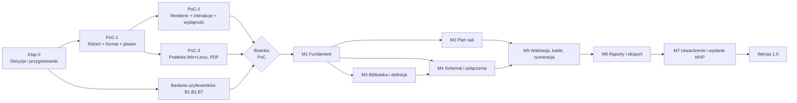

# IMPLEMENTATION-PLAN — plan realizacji etapami

Status: wersja 0.1 do audytu · 2026-10-31

Plan prowadzi od decyzji właściciela, przez małe prototypy techniczne (PoC), do MVP i dalej. **Nie rozpoczynamy kodowania aplikacji przed zatwierdzeniem decyzji z Etapu 0.** Odwołania: funkcje `F-xx` i testy `TS-xx` z [MVP-SCOPE.md](MVP-SCOPE.md), `ADR-xxx` z [DECISIONS.md](DECISIONS.md), ryzyka `R#` z [ARCHITECTURE §12](ARCHITECTURE.md), pytania `Q-xx` z [OPEN-QUESTIONS.md](OPEN-QUESTIONS.md).

## 0. Rozróżnienie poziomów

| Poziom | Cel | Jakość kodu | Co jest wynikiem |
|---|---|---|---|
| **PoC** (Proof of Concept) | Sprawdzić najtrudniejsze założenia architektury i zmierzyć, zanim zostaną „wmurowane" | Wyrzucalny lub minimalny; liczy się wiedza | Raport pomiarów + decyzje (potwierdzone/zmienione ADR) |
| **MVP** | Scenariusz referencyjny od zera do dokumentacji | Produkcyjna jakość rdzenia, testy | Wydanie alfa/beta dla pierwszych użytkowników (0.x) |
| **Wersja 1.0** | Stabilny produkt dla P1–P2 | Stabilny format, migracje, dokumentacja | Wydanie 1.0 |
| **Rozszerzenia** | Nowe możliwości po 1.0 | wg potrzeb | Kolejne wydania |

## 1. Szacunki wysiłku — zastrzeżenie

Szacunki w osobotygodniach (ow) **nie są harmonogramem ani terminem** (zwłaszcza dla pracy okazjonalnej lub prowadzonej z udziałem agentów) i podlegają reestymacji dopiero po pomiarach PoC. Zakładają **jednego doświadczonego programistę full-stack pracującego pełnoetatowo** i są **rzędami wielkości [HIPOTEZA]**, nie zobowiązaniem. Nie znamy składu zespołu ani dostępności (Q-08). Szacunki ulegną korekcie po PoC. Najbardziej niepewne są: silnik edytora (M2/M4), biblioteka startowa (M3) i eksport (M6).

## 2. Przegląd etapów i zależności

M2, M3 i M4 mogą częściowo biec równolegle przy większym zespole; solo — sekwencyjnie M1 → M3 → M4 → M2 → M5 → M6 → M7 jest bezpieczniejsze (najpierw model i połączenia, plan potem), ale **plan sali jest wymagany w scenariuszu**, więc kolejność nie zmienia zakresu.

## 3. Etap 0 — Decyzje i przygotowanie (bez kodu aplikacji)

| Pozycja | Treść |
|---|---|
| **Cel** | Usunąć decyzje blokujące start i zredukować największe niewiadome produktowe |
| **Zakres** | (1) Zatwierdzenie decyzji właściciela z listy §10 raportu/OPEN-QUESTIONS: licencja, nazwa, priorytet person, sprzęt referencyjny, polityka biblioteki, skład zespołu; (2) 3–5 wywiadów z technikami/realizatorami i zebranie 5–10 prawdziwych dokumentacji (B1, B7); (3) krótki przegląd narzędzi do planów sal (B2); (4) audyt licencji i stanu zależności z ARCHITECTURE §15; (5) higiena repozytorium: wykluczenie `research/**/_sources`, `testdata` z publikacji (ADR-020); (6) przygotowanie środowiska: założenie repozytorium, CI, szablony (**dopiero po zatwierdzeniu**; poza zakresem tej dokumentacji) |
| **Zależności** | Brak |
| **Kryteria ukończenia** | Zatwierdzone ADR-016, 019, 020 oraz odpowiedzi na Q-01…Q-09; raport z wywiadów; lista zależności z potwierdzonymi licencjami |
| **Testy** | — |
| **Ryzyka** | R7, R8, R9, R10 |
| **Rezultat** | Dokument „Decyzje zatwierdzone" i lista wymagań skorygowana o wnioski z wywiadów |
| **Wysiłek** | 2–3 ow (głównie badania) |

## 4. Etapy PoC — prototypy sprawdzające najtrudniejsze założenia

Najtrudniejsze założenia: (a) model z rewizjami definicji, kaskadami i niezmiennikami daje się zrealizować prosto i nie psuje się pod losowymi sekwencjami; (b) format ZIP+JSON jest wystarczająco szybki; (c) Canvas 2D osiąga cele wydajności na maszynie referencyjnej; (d) Tauri/WebKitGTK działa na Linuxie; (e) eksport PDF w skali z polskimi znakami jest wykonalny; (f) własny silnik edytora mieści się w budżecie.

### PoC-1 — Rdzeń, format i pionowy plaster (bez GUI)

| Pozycja | Treść |
|---|---|
| **Cel** | Udowodnić model danych i poleceń; zmierzyć format; zbudować **pionowy plaster** „urządzenie → połączenie → lista kabli CSV" (obrona przed pułapką 2) |
| **Zakres** | Pakiet `core` w TS: typy i schemat, ID, kolekcje-mapy; polecenia (dodaj instancję, połącz, usuń z kaskadą, zmień etykietę portu, zmień rewizję definicji) z łatami i cofaniem; niezmienniki; walidacja V-001/002/010/012; serializacja kanoniczna, kontener ZIP, migracja v0→v1 (przykładowa); generator syntetycznych projektów (do 5 000 obiektów); raport „lista kabli" jako zapytanie; CLI: `validate`, `report cables --csv` |
| **Zależności** | Etap 0 (licencja, nazwa — mogą być robocze) |
| **Kryteria ukończenia** | TS-02 (testy własności 10 000 losowych sekwencji: brak wiszących referencji, cofnięcie = stan początkowy); round-trip z nieznanymi polami; plik przykładowy z DOMAIN-MODEL §12 ładuje się, waliduje i generuje poprawną listę kabli; pomiar: ładowanie 5 000 obiektów, zapis, rozmiar pliku, czas walidacji przyrostowej |
| **Testy** | Jednostkowe, własnościowe, golden CSV, benchmarki |
| **Ryzyka** | R3, R6 |
| **Rezultat do pokazania** | `stagewire validate przyklad.stagewire` oraz `report cables` w terminalu; raport pomiarów; plik wzorcowy v1 |
| **Wysiłek** | 2–3 ow |

### PoC-2 — Renderer, interakcje i wydajność

| Pozycja | Treść |
|---|---|
| **Cel** | Zweryfikować silnik edytora i cele wydajności; sprawdzić, czy własny silnik mieści się w budżecie |
| **Zakres** | (1) Warstwa `render`: model + widok → `DrawList` (plan: obrysy w mm; diagram: węzły z portami + krawędzie ortogonalne); (2) Canvas 2D z R-drzewem, wirtualizacją, pan/zoom, zaznaczanie, przeciąganie, przyciąganie do siatki; (3) gest port → port z podświetleniem zgodności; (4) generator 1 000 / 2 000 / 5 000 elementów; (5) **wariant bazowy SVG z wirtualizacją** do porównania; (6) eksport SVG z tej samej DrawList i test skali (8000 mm → 80 mm przy 1:100); (7) pomiar nakładu pracy |
| **Zależności** | PoC-1 |
| **Kryteria ukończenia** | Pomiary na maszynie referencyjnej: fps pan/zoom i przeciągania, czas pierwszego rysowania, pamięć; porównanie Canvas vs SVG; decyzja o rendererze i o React Flow (R2); test skali SVG |
| **Testy** | Benchmarki, test golden DrawList, test dokładności skali |
| **Ryzyka** | R1, R2 |
| **Rezultat do pokazania** | Prototyp w przeglądarce: plan z 2 000 obiektów, diagram z przeciąganiem portów, eksport SVG; tabela pomiarów |
| **Wysiłek** | 3–5 ow |

### PoC-3 — Powłoka, zapis atomowy i PDF

| Pozycja | Treść |
|---|---|
| **Cel** | Potwierdzić Tauri 2 na Windows i **Linuxie**, zapis atomowy, odzyskiwanie i eksport PDF z polskimi znakami |
| **Zakres** | Minimalna aplikacja Tauri otwierająca prototyp z PoC-2; implementacja `Platform` (otwórz/zapisz, atomowy zapis, kopie, autozapis, blokada); eksport PDF z DrawList (pdf-lib + osadzona czcionka z polskimi znakami); test na maszynie referencyjnej z Linuxem (co najmniej jedna starsza dystrybucja LTS) i Windows; ten sam prototyp w Electron jako punkt odniesienia |
| **Zależności** | PoC-1 (format), PoC-2 (prototyp UI; można zacząć od prostego widoku) |
| **Kryteria ukończenia** | TS-04 (zapis atomowy, odzyskiwanie) i TS-14 (PDF, polskie znaki) przechodzą na obu systemach; fps na Linuxie nie gorsze niż 70% wyniku w Chromium **albo** decyzja o przejściu na Electron (ADR-016) |
| **Testy** | Ręczne scenariusze awarii zapisu, test PDF, benchmark Linux/Windows |
| **Ryzyka** | R1, R4 |
| **Rezultat do pokazania** | Instalatory/wersje przenośne z prototypem; zapis, awaria, odzyskanie, PDF |
| **Wysiłek** | 1–2 ow |

### Status PoC (2026-11-01)

| PoC | Status | Wynik |
|---|---|---|
| PoC-1 | wykonany | `POC1-RESULTS.md` |
| PoC-2 | wykonany | `POC2-RESULTS.md`: Canvas 2D potwierdzony |
| PoC-3 | wykonany z zastrzeżeniami | `POC3-RESULTS.md`: Tauri potwierdzony warunkowo; brak pomiaru na natywnym Linuxie, autozapisu i instalatorów |
| PoC-3b | wykonany | `POC3B-RESULTS.md`: gest „port → port" poprawny w 90/90 próbach, tani; przeciąganie węzła przyrostowe (0,7 ms/klatkę przy 2000); `connect` przyrostowe (19 ms przy 2000); do M3 zostaje cofanie układu węzłów i przyrostowe cofanie/usuwanie |
| M1 (autozapis, odzyskiwanie, menu plików) | wykonane; menu plików 15/15 w Chromium z atrapą okien, start i zapis sprawdzone w prawdziwym Tauri; natywne okna plików nieotwarte | ADR-038: logika + 12 testów, scenariusz awarii w Tauri 8/8 (Windows, Linux/WSL2), okno odzyskiwania w edytorze 12/12 (Chromium z atrapą Tauri); brak otwierania plików z menu; CSP wymaga walidatora bez `eval` |
| M2 (katalog + edycja definicji) | wykonane | ADR-039/040: pakiet startowy 14 urządzeń, wyszukiwanie, edycja definicji z rewizjami i wpływem, aktualizacja instancji, panel właściwości; 20 testów jednostkowych + 7/7 i 15/15 w interfejsie; brak forka definicji, importu pakietów i mapowania portów |
| M3e (sala dowolnego kształtu, obiekty sceniczne) | wykonane w prototypie | ADR-055: obrys wielokątny (okno sali, wzory, rysowanie na planie, walidacja, V-030), bryły sceniczne (kostki, podesty, ściany; kolor, wymiary, Z, powielanie) na planie i w 3D |
| M3f (trasa po bryle, wiele sal, podkład z pliku) | wykonane w prototypie | ADR-056: trasa układana po bryłach (stopnie, podesty); ADR-057: wiele pomieszczeń z położeniem w budynku i listą sal; ADR-058: podkład z PDF/SVG/DXF/obrazu ze skalowaniem dwoma punktami (DWG: zapis jako DXF/PDF) |
| M3g (przejścia między salami, układ paska) | wykonane w prototypie | ADR-059: przejścia kablowe między salami (FOH ↔ scena) z liczeniem długości kabli; ADR-060: pasek narzędzi w grupach z podpisami, bez nakładania paneli |
| M3h | Uwagi z testów w oknie (ADR-061): mipmapy podkładu, panel „Przeciągnij…”, blokada położenia, poziom podłogi sali, nazwy plików eksportu, grupy i „Uporządkuj” na schemacie, numeracja i spis w PDF planu, menu ☰ + „O programie” | zrobione |
| M3i | Biblioteka (ADR-063): przeglądarka z filtrami fasetowymi, kreator urządzenia, pojedyncze urządzenia (eksport/import/usuwanie w Moich), kolory kabli i ustawienia (ADR-062) | zrobione |
| M7a (CSP i instalator Windows) | wykonane w prototypie | ADR-054: ścisła CSP bez unsafe-eval, walidator schematu generowany z wyprzedzeniem, test CSP, instalator NSIS per użytkownik (niepodpisany); Linux: budowa na WSL2/Linuksie nadal otwarta |
| M3d (widok 3D sali) | wykonane w prototypie | ADR-053: perspektywa na Canvas 2D, obrót/przesuwanie/zoom, zaznaczanie, trasy 3D, tylko odczyt; brak eksportu |
| M3c (szafy i rozdzielnice DIN) | wykonane w prototypie (etap 1) | ADR-052: obudowa z szynami, osprzęt `dinModules`, opinanie przewodami, terminale, V-028/V-029; blok szafy na schemacie (etap 2, zrobiony); PDF szafy (zrobiony); moduł 3U w racku (zrobiony); szafa na planie sali (zrobiona) |
| M3b (racki: elewacja, montaż, raport PDF) | wykonane w prototypie | ADR-051: rack jako obiekt, `mount` w instancji, V-003/V-027, widok z przeciąganiem, sumy masy i mocy, PDF; rack na planie sali i w estymacie długości (dodane); brak półek, szaf 2-słupkowych i PDU |
| M2 (baza urządzeń: pakiety, biblioteka, fork) | wykonane częściowo | ADR-049/050, DEVICE-DB.md: format pakietu z walidacją i źródłami (wiarygodność danych), katalog z pakietów, atomowa instalacja ze statusem wersji i konfliktami rejestrów, jawna aktualizacja definicji z nowszego pakietu, zasilanie i grupy jako porty, folder biblioteki użytkownika, import/eksport, rozszerzona edycja definicji, fork, CLI; brak edycji wielu sygnałów na port oraz nowych pól w oknie definicji, bilansu mocy |
| M3 (układ diagramu, Q-28) | wykonane częściowo | ADR-041: pozycje węzłów w projekcie (`views`), przesunięcie i dodanie = krok cofania, układ przetrwa zapis; brak łączenia kolejnych ruchów, brak auto-przesuwania widoku przy krawędzi, brak przyrostowego cofania (pełna przebudowa listy) |
| M2/M4 (plan sali, wersja minimalna) | wykonane częściowo | ADR-042: sala prostokątna, rozmieszczanie przeciąganiem (siatka 100 mm), obrót, pozycja liczbowa, podziałka, kable na planie; 17/17 w interfejsie; brak sal wielokątnych, podkładu, wymiarowania, auto-długości kabli z planu |
| M4 (3D w danych planu) | wykonane | ADR-045: z urządzeń, trasy [x,y,z], wysokość sali, długości kabli w 3D; widok nadal 2D z góry, bez pochylenia/przechyłu |
| M6 (eksport PDF: plan, schemat, lista kabli) | wykonane częściowo | ADR-047/048: plan w skali (A4–A1), schemat na dobranym papierze, lista kabli wielostronicowa z podsumowaniem; brak kolorów, wymiarowania, zestawu w jednym pliku, oceny wzrokowej |
| Pierwsze próby użycia (projekt1) | wykonane | ADR-046: blokada zajętego portu, potwierdzenie niezgodnych połączeń, kolorowanie i lista uwag, kable po trasach na planie, etykiety bez nakładania, pion trasy, kabel dla połączeń bez kabla |
| M5 (trasy kablowe na planie) | wykonane | ADR-044: rysowanie łamanych, edycja punktów (przesuwanie, dodawanie, usuwanie), sieć tras z Dijkstrą, długość kabla po trasie, awaryjnie prosto; brak pojemności korytek, podświetlenia ścieżki kabla |
| M5 (długości z planu) | wykonane | ADR-043: Manhattan + zapas, zaokrąglenie do 0,1 m, oznaczenie „~”, ręczne nietknięte; zapas 1 m to hipoteza do weryfikacji |
| M5 (lista kabli w interfejsie) | wykonane częściowo | Klik kabla w widoku głównym: panel (etykieta przy wyjściu z urządzenia, numer, długość; 7/7); Okno „Lista kabli”: tabela patchlisty, numeracja brakujących (V001…), długości w metrach (cofalne), eksport CSV (UTF-8 BOM, średnik; okno zapisu w aplikacji nie sprawdzone ręcznie); 8/8 w interfejsie; brak raportu PDF, sortowania/filtrów i przydziału z magazynu |

### Bramka PoC (przegląd decyzji)

Przegląd wyników PoC-1…3 i badań z Etapu 0. Wynikiem jest potwierdzenie lub korekta: ADR-014 (format), ADR-016 (stos), ADR-017 (renderer), ADR-005/-004 (model, jeśli PoC-1 wykaże nadmierną złożoność), zakresu [S] w MVP i szacunków. **Jeśli któreś z kryteriów wydajności nie jest osiągalne, zmieniamy wymaganie albo technologię przed M1, a nie po.**

## 5. Etapy MVP

Każdy etap kończy się działającym rezultatem do zademonstrowania i przypisanymi testami. Etapy M1–M7 realizują funkcje `F-01…F-13` (M) i wybrane [S].

### M1 — Fundament aplikacji

| Pozycja | Treść |
|---|---|
| **Cel** | Szkielet aplikacji z modelem, plikiem i cofaniem |
| **Zakres** | Produkcyjny `core` (model v1, polecenia, niezmienniki, format, migracje); aplikacja desktop: ekran startowy, nowy/otwórz/zapisz, autozapis i odzyskiwanie, kopie, blokada; undo/redo; panel struktury i panel właściwości (szkielet); i18n PL/EN; wskaźnik zapisu |
| **Zależności** | Bramka PoC |
| **Kryteria ukończenia** | F-01, F-02 spełnione; TS-02, TS-04, TS-05, TS-09, TS-10 (część) przechodzą |
| **Testy** | Własnościowe, awarie zapisu, migracje, offline |
| **Ryzyka** | R3, R6 |
| **Rezultat** | Aplikacja otwiera/zapisuje projekt z kilkoma obiektami testowymi (jeszcze bez edytorów graficznych), cofanie działa, plik przenosi się między systemami |
| **Wysiłek** | 3–4 ow |

### M3 — Biblioteka i edytor definicji *(wykonywany przed M4)*

| Pozycja | Treść |
|---|---|
| **Cel** | Urządzenia z portami dostępne i edytowalne |
| **Zakres** | Rejestry (złącza, sygnały, kable) z mechanizmem własnych wpisów; paczki biblioteki, indeks i wyszukiwanie z fasetami; edytor definicji z podglądem, szybkie porty, fork; rewizje i osadzanie w projekcie; linter paczek (CLI); **biblioteka startowa** (~40–60 definicji, rejestry, obiekty sceny) wraz z procesem weryfikacji źródeł; import/eksport paczki |
| **Zależności** | M1, wynik Q-07 (polityka źródeł danych) |
| **Kryteria ukończenia** | F-04, F-05 (bez UI planu/diagramu — dodawanie z listy), upgrade podstawowy; TS-13a, TS-15; wyszukiwanie < 100 ms/5 000 definicji; każdy wpis ma pochodzenie i licencję |
| **Testy** | Linter paczek, testy rewizji, wyszukiwanie, wydajność |
| **Ryzyka** | R5 (największe: autorstwo danych), R3 |
| **Rezultat** | Można utworzyć własne urządzenie, znaleźć i dodać urządzenie z biblioteki, przenieść projekt z definicjami |
| **Wysiłek** | 4–6 ow (+ praca nad treścią biblioteki równolegle) |

### M4 — Schemat blokowy i połączenia

| Pozycja | Treść |
|---|---|
| **Cel** | Pełny przepływ „urządzenia → połączenia" na diagramie |
| **Zakres** | Widok diagramu na silniku z PoC-2 (zaakceptowanym w bramce): węzły z portami, tworzenie połączeń z podświetleniem zgodności i powodami niezgodności, krawędzie ortogonalne i waypointy, ramki, wiele diagramów, „usuń z widoku/z projektu", okno skutków, panel właściwości połączenia i kabla; `Connection` + `Cable` 1:1 |
| **Zależności** | M1, M3 |
| **Kryteria ukończenia** | F-06, F-07 (bez numeracji i długości); TS-03, TS-12; cele wydajności diagramu |
| **Testy** | Interakcje (Playwright), golden DrawList, wydajność, własnościowe z udziałem poleceń UI |
| **Ryzyka** | R2, R1 |
| **Rezultat** | Można zbudować schemat systemu z kilkudziesięciu urządzeń i ~40 połączeń |
| **Wysiłek** | 5–7 ow |

### M2 — Plan sali w skali

| Pozycja | Treść |
|---|---|
| **Cel** | Rysowanie sali i rozmieszczanie obiektów w rzeczywistej skali |
| **Zakres** | Widok planu: przestrzeń, strefy, obiekty sceny, urządzenia z `Placement` (X/Y/Z, obrót), siatka, przyciąganie, wpisywanie wymiarów, wymiary i teksty, kopiuj/wklej/wyrównaj, podpowiedź strefy, wielokrotne zaznaczanie; layout wydruku (papier, skala, tabliczka); **podkład PNG/JPG z kalibracją (F-15a, [M])**; [S] podkład PDF (F-15b) i nakładka kabli (F-17) |
| **Zależności** | M1, M3 (obiekty do rozmieszczenia) |
| **Kryteria ukończenia** | F-03; TS-07 (skala), TS-08 (część planu); [S] F-15 zgodnie z deklaracją |
| **Testy** | Dokładność skali (golden SVG/PDF), interakcje, wydajność |
| **Ryzyka** | R1, R2, B2 |
| **Rezultat** | Można narysować salę 20×15 m ze sceną i rozmieścić sprzęt; eksport SVG w skali |
| **Wysiłek** | 5–7 ow |

### M5 — Walidacja, numeracja i długości kabli

| Pozycja | Treść |
|---|---|
| **Cel** | Wyjaśnialna walidacja oraz kompletne dane kabli |
| **Zakres** | Silnik reguł (V-001…V-024), przyrostowa walidacja, panel problemów, nawigacja, odznaki, odrzucanie z uzasadnieniem, poziomy; numeracja kabli (wzorce, polecenia); długość ręczna i [S] estymata z planu (F-16) z zapasami i długościami katalogowymi; [S] racki: przypisanie, V-003, raport zawartości (F-14); [S] atrybuty portów (F-21) |
| **Zależności** | M4, M2 (dla estymaty) |
| **Kryteria ukończenia** | F-07 (kompletne), F-08; TS-06, TS-11 (część), TS-08 (walidacja) |
| **Testy** | Reguły po jednym teście dodatnim i ujemnym; własnościowe; wydajność |
| **Ryzyka** | R3, R7 |
| **Rezultat** | Scenariusz referencyjny daje listę problemów z działającą nawigacją i naprawami |
| **Wysiłek** | 3–4 ow |

### M6 — Raporty i eksport dokumentacji

| Pozycja | Treść |
|---|---|
| **Cel** | Komplet dokumentacji dla ekipy |
| **Zakres** | Raporty: lista sprzętu, lista kabli, patchlista, packlista (z postępem i extras), połączenia urządzenia; tabele z sortowaniem/filtrem; CSV (UTF-8 BOM) i PDF; eksport planu i schematu do PDF/SVG/PNG z tabliczką; pakiet dokumentacji; [S] ścieżki end-to-end przez patchpanel (F-20), etykiety (F-22), XLSX (F-23) |
| **Zależności** | M5 |
| **Kryteria ukończenia** | F-10, F-11, F-12; TS-01 (pełny przebieg), TS-07, TS-10, TS-11, TS-14 |
| **Testy** | Golden PDF/CSV, scenariusze referencyjne, ręczny przegląd dokumentów z realnymi ekipami (B7) |
| **Ryzyka** | R4, B7 |
| **Rezultat** | Wygenerowany komplet dokumentów scenariusza referencyjnego |
| **Wysiłek** | 4–5 ow |

### M7 — Utwardzenie i wydanie MVP

| Pozycja | Treść |
|---|---|
| **Cel** | Gotowość do udostępnienia pierwszym użytkownikom |
| **Zakres** | Pełny przebieg TS-01…TS-15 (warianty [M]) na obu systemach; poprawa wydajności; dostępność (F-13, panel struktury); instalatory i wersja przenośna; dokumentacja użytkownika i specyfikacja formatu; audyt licencji zależności i biblioteki (ADR-019/020); test z osobą spoza zespołu; szablon projektu „Konferencja"; stabilizacja formatu 1.0.0-rc |
| **Zależności** | M6 |
| **Kryteria ukończenia** | §10 w MVP-SCOPE (definicja ukończenia) |
| **Testy** | Pełna regresja, testy użytkowników |
| **Ryzyka** | R7, R9, R10 |
| **Rezultat** | Wydanie 0.x (beta) z instalatorami i dokumentacją |
| **Wysiłek** | 3–4 ow |

**Suma MVP:** ok. 27–37 ow + PoC ok. 6–10 ow + Etap 0 ok. 2–3 ow, czyli łącznie rzędu 35–50 ow solo, przy czym szacunek jest niepewny i zależy od zakresu [S] oraz zespołu (Q-08, Q-10).

## 6. Wersja 1.0 — definicja

Wersja 1.0 oznacza **stabilność i kompletność dla person P1–P2**, nie dodawanie wszystkiego. Kandydaci (po decyzji właściciela i badaniach):

| Obszar | Funkcje |
|---|---|
| Fizyka | Edytor elewacji racka; multicore w UI; wymiana definicji z mapowaniem portów (Replace); porównanie wersji projektu |
| Dokumentacja | Szablony tabliczki i raportów użytkownika; pełne etykiety; XLSX |
| Plan | Użytkownikowe warstwy; podkład PDF z wieloma stronami; sprawdzone symbole sceny |
| Model / zasilanie | Zasilanie (bilans mocy, rozdzielnie) — kandydat na v1.0, jeśli B10 potwierdzi potrzebę; rigging po v1.0. Przed startem ustalić z StageCalc podział: własny moduł, współdzielone dane czy synchronizacja (Q-25) |
| Rodzina GreenCrew | Eksport/import wspólnych danych (urządzenie: moc, masa, pozycja) i porównanie projektu z inwentaryzacją z CableListTool — po decyzji o synchronizacji (ADR-035, Q-25) |
| Stabilność | Zamrożony format 1.0 z gwarancją migracji; dokumentacja formatu; narzędzia CLI |
| Jakość | Przegląd dostępności, wydajność na maszynie referencyjnej, internacjonalizacja kolejnych języków |
| Biblioteka | Proces wkładu społeczności (DCO), weryfikacja, publikacja paczek |

## 7. Rozszerzenia po 1.0 (kierunki, bez zobowiązań)

Sieć tras kablowych 3D i analiza tras; logiczne przepływy (Dante, NDI, VLAN); import/eksport IFC (np. most do BIMCraft), MVR/GDTF, DXF; widok 3D; współpraca i synchronizacja, self-hosting; wtyczki i własne reguły walidacji; wersja przeglądarkowa; generator dokumentacji z szablonami; integracje z narzędziami produkcyjnymi.

## 8. Audyt spójności dokumentacji

Lista kontrolna do wykonania w bramce i przy każdej zmianie zakresu. Wynik przeglądu wewnętrznego autora z 2026-10-31. **Niezależny audyt statyczny z 2026-10-31 (`STAGEWIRE-MVP-AUDIT-2026-10-31.md`) wykazał 4 problemy P0 i 11 P1; ich rejestr i status poprawek jest w §8.3. Odpowiedzi poniżej nie są uznane za zamknięte, dopóki bramki z §8.3 nie są spełnione.**

| Pytanie | Wynik |
|---|---|
| Czy MVP wynika z wizji? | Tak: wizja §6.1 ↔ F-01…F-13; granice wizji §6.2 ↔ lista wykluczonych |
| Czy architektura obsługuje wymagane funkcje? | Tak: każda funkcja F-xx ma odpowiednik w warstwach `@core`/UI; **warunkowo** wydajność (R1) i PDF (R4), sprawdzane w PoC |
| Czy plan prowadzi do MVP? | Tak: M1–M7 pokrywają F-01…F-13; mapowanie poniżej |
| Czy nie zaprojektowano zbyt skomplikowanego rozwiązania? | Największe ryzyko to własny silnik edytora (R2) i rewizje definicji (R3); oba mają bramki i plany awaryjne. Rewizje podstawowe należą do F-04 [M]; F-19 [S] to tylko zaawansowany upgrade. Wariant fork-only wymaga **zmiany ADR-004 oraz kryteriów F-04 i TS-13a**, nie samego usunięcia F-19 |
| Czy model nie wymusi przepisywania aplikacji? | Pola „R" (rezerwa) i `ext` pokrywają: gender, orientację 3D, multicore, warstwę przepływów, sieć tras; kolekcje jako mapy i stabilne ID wspierają sync |
| Czy technologie nadają się do projektu open source za darmo? | Kandydaci MIT/Apache; audyt licencji w Etapie 0 (R9) |

### 8.1 Pokrycie funkcji przez etapy

| Funkcja | Etap |
|---|---|
| F-01, F-02 | M1 |
| F-04, F-05 | M3 (+ UI dodawania w M2/M4) |
| F-06 | M4 |
| F-07 | M4 (połączenia), M5 (numeracja, długości) |
| F-03 | M2 |
| F-08 | M5 |
| F-09 | M1 (szkielet) → M2/M4/M5 (pola) |
| F-10, F-11, F-12 | M6 |
| F-13 | M1 (i18n, zapis) → M7 (dostępność) |
| F-15a [M] | M2 |
| F-14…F-24 [S] | M2 (F-15b, F-17), M3 (F-19), M5 (F-14, F-16, F-21), M6 (F-20, F-22, F-23), M7/C (F-18, F-24) |

### 8.2 Znane niespójności i otwarte punkty

| # | Punkt | Decyzja |
|---|---|---|
| 1 | Packlista przechowuje stan „spakowane" jako dane użytkownika — uwzględnione w DOMAIN-MODEL §5.1 (`packing`) | Zamknięte |
| 2 | Kolejność M3 przed M4 w numeracji etapów (M2 jest planem) | Numeracja utrzymana ze względu na logikę funkcjonalną; kolejność wykonania w §2 |
| 3 | Szacunki wysiłku nie zostały zweryfikowane | Korekta po PoC |
| 4 | Przykładowy plik w DOMAIN-MODEL §12 jest ilustracyjny i nie był walidowany schematem (schemat nie istnieje); poprawny składniowo JSON nie dowodzi poprawności modelu (audyt P0-01) | Pierwsze zadanie PoC-1: schemat + walidacja przykładu + fixtures z §9 |

### 8.3 Rejestr audytu z 2026-10-31 i status poprawek

Status „Poprawiono w dokumentach" oznacza zmianę tekstu; **nie** oznacza zaakceptowania przez audytora ani zweryfikowania w PoC.

| ID | Temat | Status | Gdzie |
|---|---|---|---|
| P0-01 | Wiele rewizji w jednej mapie | Poprawiono: `definitions[id].revisions[n]`, rewizje niemutowalne, reguły osadzania/upgrade/fork/import/usunięcia portu; fixture w PoC-1 | DOMAIN-MODEL §5.3, §12; ADR-004 |
| P0-02 | Zgodność portów i kabli | Poprawiono: usunięto `matesWith`; kabel ma `endPairs`; V-011 trójwartościowy; gender nadal rezerwą | DOMAIN-MODEL §5.2, §7; ADR-029 |
| P0-03 | Dwuznaczne `cableId = null` | Poprawiono: `Connection.medium`, V-019 | DOMAIN-MODEL §5.11, §6; ADR-006 |
| P0-04 | Testy zależne od [S] | Poprawiono: profil Core, TS-01 bez [S], TS-01+/06+/13b warunkowe, matryca §9a | MVP-SCOPE §9, §9a; ADR-030 |
| P1-01 | Brak jednej specyfikacji kolekcji | Poprawiono: mapy na dysku i w pamięci; normatywny JSON Schema | DOMAIN-MODEL §10 |
| P1-02 | Nieaktualne estymaty, różne `Space` | Poprawiono: `estimateBasis`, V-025, odmowa między `Space` | DOMAIN-MODEL §5.12, §8 |
| P1-03 | Obiekty sceny w raportach, klucz `packing` | Poprawiono: raport elementów sceny, klucze z `supply`, reguła `min()` | MVP-SCOPE F-10; DOMAIN-MODEL §5.1 |
| P1-04 | Priorytet podkładu planu | Zmieniono propozycję: F-15a [M]. **Wymaga zatwierdzenia właściciela (Q-10)** | MVP-SCOPE F-15a |
| P1-05 | Brak toru lighting/DMX | Dodano mini-test TS-15 (3 definicje, kratownica); bez modułu oświetleniowego (Q-20) | MVP-SCOPE §7, §9 |
| P1-06 | Gwarancje trwałości ZIP | Poprawiono: usunięto twierdzenie o odporności ZIP; macierz awarii Win/Linux; weryfikacja po zapisie | ARCHITECTURE §5.2 |
| P1-07 | Nowszy MAJOR | Poprawiono: bez zapisu i migracji; podgląd tylko gdy parsowalny | DOMAIN-MODEL §10; F-01; UX §11 |
| P1-08 | Pozycja sprzętu w racku i na podeście | Poprawiono: `effectivePosition`, U = 44,45 mm, `z` na podeście jawne | DOMAIN-MODEL §8 |
| P1-09 | Naprawa V-001 | Poprawiono: „wskaż inny port docelowy" | DOMAIN-MODEL §7 |
| P1-10 | Szacunki osobotygodni | Poprawiono: jawnie „nie harmonogram", reestymacja po PoC | §1 |
| P1-11 | Definicja Linuxa | Zaproponowano: Ubuntu 22.04/24.04, `webkit2gtk-4.1`, Windows 10 22H2/11. **Wymaga zatwierdzenia (Q-09)** | MVP-SCOPE §8; ARCHITECTURE §2.4 |
| P2 | Doprecyzowania | Poprawiono: klucze packlisty, `StageObject` bez definicji/rewizji, F-12 przenośny vs stratny, nieznane pola, progi PoC, higiena repozytorium | ADR-020 i j.w. |

### 8.5 Trzeci przegląd z 2026-11-01 (`STAGEWIRE-MVP-THIRD-REVIEW-2026-11-01.md`)

N-01…N-09: 9/9 zatwierdzone na poziomie dokumentacji (nie wykonawczo). Dwie decyzje wykonawcze i cztery uwagi redakcyjne:

| ID | Temat | Rozstrzygnięcie |
|---|---|---|
| S-01 | Identyfikatory: klucz mapy czy pole | Format dyskowy: klucz mapy jest identyfikatorem (w tym numer rewizji i `RegistryEntry.key`); pola w tabelach §5 są logiczne; schemat akceptuje przykład §12 bez redundantnych pól (DOMAIN-MODEL §5.1a) |
| S-02 | Przydział krótszy od trasy | Reguła V-026 (M5); fixture 12000/10000, 12000/15000, 12000/20000 w PoC-1 |
| red. | §8 „rewizje mogą wypaść z F-19" | Poprawione (rewizje podstawowe w F-04; fork-only = zmiana ADR-004, F-04, TS-13a) |
| red. | MVP-SCOPE §1: plaster w PoC-2 | Poprawione: kanoniczny jest PoC-1 (§4, §9 tego planu) |
| red. | TS-07 duplikat „eksport SVG zgodny" | Poprawione |
| red. | Lista dozwolonych tablic niekompletna | Uzupełniona o `ReportDefinition.columns/groupBy/sortBy`; lista wyczerpująca |

Zalecany następny krok z przeglądu: PoC-1 zaczyna się od JSON Schema i fixtures (dwie rewizje, `physical` z kablem i bez, `wireless`/`virtual`, DMX, trzy warianty długości/przydziału). Format pozostaje niezwalidowany wykonawczo.

### 8.4 Reaudyt z 2026-11-01 (`STAGEWIRE-MVP-REAUDIT-2026-11-01.md`)

Reaudyt uznał 4/4 P0 za naprawione koncepcyjnie i wskazał 9 nowych niezgodności. Status poprawek (tekst zmieniony; **nie ponownie zaudytowany**):

| ID | Temat | Poprawka | Gdzie |
|---|---|---|---|
| N-01 | Tabele z tablicami vs mapy | Wszystkie kolekcje i `ports` to `Record<ID,T>`; wyjątki tablicowe wymienione; Q-12 rozstrzygnięte warunkowo | DOMAIN-MODEL §5.1, §5.3 |
| N-02 | V-011/V-013 dla wireless/virtual | Tylko `physical` z przypisanym kablem; test w TS-06 | DOMAIN-MODEL §7; MVP-SCOPE F-07/F-08 |
| N-03 | „Przepnij" w upgrade Core | Core: usuń/anuluj; przepinanie w F-19 [S]; ADR-004 poprawiony | DOMAIN-MODEL §6; ADR-004 |
| N-04 | Długość wymagana vs przydzielona | `lengthMm` + `stockLengthMm?`; propozycja oznaczona; test 12 m / 10-15-20 | DOMAIN-MODEL §5.12; ADR-031; F-10 |
| N-05 | Obowiązkowy podkład w teście | Odrębny, obowiązkowy TS-07a | MVP-SCOPE |
| N-06 | Pruning rewizji vs undo | Pruning tylko przy serializacji; test upgrade→zapis→cofnij | DOMAIN-MODEL §5.3 |
| N-07 | Licznik packlisty 5→3→5 | Trwałe przycinanie licznika | DOMAIN-MODEL §5.1 |
| N-08 | Podest jako 1 sztuka | Obrys koncepcyjny; moduły ręcznie | DOMAIN-MODEL §5.7; F-10 |
| N-09 | „Gotowe na multicore" | Zdanie złagodzone; multicore = osobny projekt v1.0 | DOMAIN-MODEL §5.12; ADR-006 |

Decyzje właściciela wskazane przez reaudyt (nadal otwarte): F-15a [M] (Q-10), profil Core jako próg ukończenia (Q-19), TS-15 jako test modelu (Q-20), platformy i maszyna (Q-09), wybór renderera i powłoki dopiero po pomiarze (bramka PoC), czysta historia repozytorium (Q-22). Roboczy wybór React + TypeScript pozostaje; Canvas2D vs SVG i Tauri vs Electron decyduje pomiar, nie opinia.

Bramki akceptacyjne z audytu (odhaczać po PoC-1, nie wcześniej): dwie rewizje współistnieją po ponownym otwarciu; zmiana etykiety nie zrywa połączeń; walidator rozróżnia sygnał / końcówki / „nie da się ocenić"; wireless i kabel nieprzypisany są rozróżnialne; TS-01 bez [S]; packlista rozdziela sprzęt, scenę i grafikę; długość ma źródło i status aktualności; trwałość przetestowana na Windows i Linuxie; materiały badawcze nie trafiają do repozytorium produktu bez kontroli.

## 9. Plan pierwszego etapu implementacji (po Etapie 0)

**PoC-1 — rdzeń, format i pionowy plaster** (szczegółowy rozkład zadań):

1. Szkielet pakietu `core` (TS strict), narzędzia testowe; bez UI.
2. Typy, ID (generator UUIDv7→base32), schemat (TypeBox → JSON Schema), kolekcje-mapy.
3. **Najpierw JSON Schema**, potem fixtures: (a) przykład z DOMAIN-MODEL §12; (b) **dwie rewizje** tej samej definicji z instancjami A (rew. 1) i B (rew. 2) i połączeniami do obu; (c) połączenia `physical` z kablem, `physical` bez kabla, `wireless`; (d) mini-DMX (TS-15); (e) projekt konferencji ~25 urządzeń. Walidacja schematem.
4. Warstwa poleceń: transakcje, łaty, cofanie; polecenia: `addInstance`, `connect`, `removeInstance` (kaskada), `renamePort`, `setDefinitionRevision`.
5. Niezmienniki i testy własnościowe (fast-check): sekwencje losowe, cofnięcie, brak wiszących referencji.
6. Indeksy i zapytania: `connectionsByPort`, raport „lista kabli".
7. Walidacja V-001, V-002, V-010, V-011 (trójwartościowa, tylko `physical` z kablem), V-012, V-019 (przyrostowa); test „upgrade → zapis → cofnij"; fixture długości (12 m, magazyn 10/15/20; przydział 10/15/20 m wobec wymaganych 12 m dla V-026).
8. Serializacja kanoniczna, kontener ZIP, odczyt z zachowaniem nieznanych pól, migracja demonstracyjna.
9. Generator syntetycznych projektów i benchmarki (ładowanie, zapis, walidacja, rozmiar).
10. CLI: `validate`, `report cables --csv`.
11. Raport z pomiarów i lista korekt modelu.

Wynik: dokument „PoC-1 — wyniki" z liczbami i wnioskami, zaktualizowane ADR-014/-004/-005 jeśli trzeba.

## 10. Warunki startu (skrót)

Przed rozpoczęciem PoC-1 muszą być rozstrzygnięte co najmniej Q-01 (nazwa robocza), Q-03 (licencja robocza), Q-08 (zespół/czas) i zatwierdzony ogólny kierunek (T1 z bramką). Pełna lista decyzji właściciela: [OPEN-QUESTIONS.md](OPEN-QUESTIONS.md) i raport końcowy.
