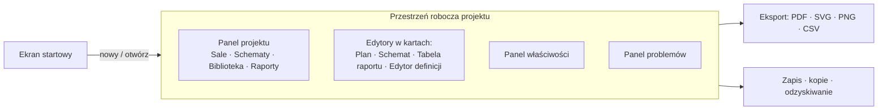

# UX-WORKFLOWS — struktura aplikacji i przepływy pracy

Status: wersja 0.1 do audytu · 2026-10-31

Priorytet: **szybkość projektowania na laptopie w czasie przygotowań do realizacji.** Nie projektujemy rozbudowanego interfejsu dlatego, że mamy dużo danych technicznych; pokazujemy to, co potrzebne w danym kroku. Ergonomia istniejących narzędzi, wywnioskowana ze struktury UI, jest wskazówką, nie wynikiem testów użyteczności [wewnętrzne materiały badawcze Q9]. Wszystkie założenia UX należy zweryfikować na prototypie z użytkownikami (B1). Funkcje `F-xx`: [MVP-SCOPE.md](MVP-SCOPE.md).

## 1. Zasady interakcji

1. **Najkrótsza droga do pierwszego rezultatu:** z ekranu startowego do edytora jeden krok; pierwszy kabel w kilka interakcji.
2. **Model jest jeden, widoków kilka:** zaznaczenie w jednym widoku jest widoczne w pozostałych („pokaż na planie / na schemacie").
3. **Gest daje informację, nie zakaz:** niezgodność jest pokazana natychmiast, ale można ją świadomie zignorować; konsekwencja trafia do listy problemów (rozstrzygnięcie K1).
4. **Odróżniaj „usuń z widoku" od „usuń z projektu".** Pierwsze nigdy nie niszczy danych.
5. **Każda operacja jest cofalna**, a operacja złożona to jeden krok cofania.
6. **Klawiatura na pierwszym miejscu:** skróty jednoliterowe, paleta poleceń, wprowadzanie liczb podczas rysowania.
7. **Nie ukrywaj stanu:** wskaźnik zapisu, liczba problemów, aktywne narzędzie, skala i współrzędne zawsze widoczne.
8. **Domyślne wartości sensowne, ustawienia rzadkie.**

## 2. Struktura aplikacji



### 2.1 Układ okna (laptop 1366 × 768 jako wymiar projektowy)

```
┌──────────────────────────────────────────────────────────────────────────────┐
│ ☰  Projekt ▾   Cofnij Ponów   [Q] Szukaj/Polecenia (Ctrl+K)    ● Zapisano   │
├───────────┬──────────────────────────────────────────────┬───────────────────┤
│ PROJEKT   │  Karty: [Plan sali] [Schemat] [Lista kabli] │ WŁAŚCIWOŚCI       │
│ ▸ Sale    │ ┌──────────────────────────────────────────┐ │                   │
│   Hala A  │ │                                          │ │ CAM1              │
│ ▸ Schematy│ │            obszar roboczy                │ │ Definicja: Camera │
│   Sygnał  │ │      (Plan lub Schemat, canvas)          │ │  SDI  (rew. 1)    │
│ ▸ Biblio- │ │                                          │ │ Strefa: FOH ▾     │
│   teka    │ │                                          │ │ Poz.: X Y Z  Obr. │
│ ▸ Raporty │ └──────────────────────────────────────────┘ │ Porty             │
│           │  narzędzia: V Zaznacz  G Dodaj  C Połącz ... │  SDI OUT → MIX1:1 │
├───────────┴──────────────────────────────────────────────┴───────────────────┤
│ ⚠ 3 błędy  ▲ 5 ostrzeżeń  ⓘ 8   │ X 8500 Y 3000 mm │ 1:100 │ Siatka 500 mm  │
└──────────────────────────────────────────────────────────────────────────────┘
```

Panele boczne zwijalne (`F1`/`F2`), panel problemów dolny zwija się do paska stanu.

### 2.2 Nawigacja między projektami i widokami

- **Ekran startowy:** „Nowy projekt" (pusty / szablon „Konferencja"), „Otwórz…", lista ostatnich z datą i miniaturą, informacja o odzyskiwalnych autozapisach.
- **Wiele projektów:** jeden projekt na okno; kolejny w nowym oknie (prosty model, brak współdzielonego stanu).
- **Wiele widoków w projekcie:** karty (tabs). Panel projektu pokazuje drzewo sal, schematów, raportów. Dwuklik otwiera kartę.
- **Cross-probe:** `Alt+klik` lub menu „Pokaż w…" na obiekcie otwiera/aktywuje inny widok, zaznaczając ten sam obiekt.

## 3. Edytor planu sali (F-03)

**Narzędzia (skróty):** `V` zaznacz · `R` prostokąt (sala/obszar) · `P` wielokąt · `Z` strefa · `G` dodaj sprzęt/obiekt · `D` wymiar · `T` tekst · `L` linia · `H` pan (lub spacja) · `M` linijka/pomiar.

**Kluczowe zachowania:**

- **Wymiary jako pierwszorzędny sposób pracy.** Podczas rysowania lub przesuwania `Tab` otwiera pole wartości (np. `20000`, `20 m`, `8000 x 4000`). Wymiary zaznaczonego obiektu widoczne i edytowalne w panelu właściwości.
- **Siatka i przyciąganie** domyślnie 500 mm (przełącznik `Shift`/`Ctrl`), przyciąganie do krawędzi i środków obiektów.
- **Rozmieszczanie sprzętu:** ghost obiektu przy kursorze po `G`; klik stawia; po upuszczeniu w strefie panel proponuje „Przypisać do strefy FOH?" (jednym kliknięciem, bez dialogu blokującego).
- **Wysokość Z:** pole w panelu (domyślnie 0 lub wysokość podestu pod obiektem — podpowiedź, nie automat).
- **Reprezentacja:** urządzenie = obrys w skali (z definicji) z ikoną i nazwą; obiekt sceny = wypełniony kształt; elementy rysunkowe = cienkie linie bez wypełnienia. Różnice wizualne wzmacniają rozdział pojęć.
- **Nakładka kabli** (`K`) — pochodne linie między urządzeniami z pozycją; kolor wg sygnału (F-17, S).
- **Podkład** (F-15, S): „Wstaw podkład → obraz/PDF → kliknij dwa punkty i wpisz odległość" (kalibracja).
- **Kamera:** kółko = zoom do kursora, `H`/spacja = pan, `F` = dopasuj do zawartości, `Shift+F` = dopasuj do zaznaczenia.
- **Wydruk:** karta „Układ wydruku" (papier, skala, tabliczka) z podglądem; nie osobny tryb edytora.

## 4. Edytor schematów blokowych (F-06)

**Węzeł urządzenia:** nagłówek (nazwa, tag, ikona) + porty. Wejścia po lewej, wyjścia po prawej, grupy portów zwijane do jednego wiersza z licznikiem. Porty kolorowane wg sygnału. Porty `io` po stronie wynikającej z `side` lub rozmieszczenia.

**Tworzenie połączenia (główny gest):**

1. Najedź na port → port się podświetla, kursor „celownik".
2. Wciśnij i przeciągnij → zgodne porty docelowych węzłów podświetlają się; niezgodne są wyszarzone, a po najechaniu pokazują **powód w jednym zdaniu** (np. „SDI OUT → HDMI IN: brak wspólnego sygnału").
3. Puść na porcie → powstaje `Connection` + `Cable` z domyślnym sygnałem i typem kabla; krawędź ortogonalna.
4. Puść na pustym polu → menu „Dodaj urządzenie zgodne z tym portem…" (szybki start) lub anuluj.
5. Puść na niezgodnym porcie → połączenie powstaje po potwierdzeniu klawiszem (`Alt` przy puszczeniu lub przycisk w dymku „Połącz mimo to"), wpada do listy problemów.

Alternatywa klawiaturowa: zaznacz port (`Tab` po portach węzła) → `C` → wybierz docelowy port z listy filtrowanej (zgodne najpierw).

**Krawędzie:** klik zaznacza; uchwyty segmentów pozwalają przesunąć krawędź (tworzy waypointy). „Resetuj trasę" usuwa waypointy. Obszar trafienia szerszy niż linia. Etykieta krawędzi: numer kabla (opcjonalnie sygnał).

**Ramki grupujące (np. „SCENA", „FOH"):** wizualne grupowanie węzłów; mogą być przypisane do strefy (podpowiedź, bez automatycznej zmiany modelu).

**Dodawanie do widoku:** `G` → wyszukaj → wstaw nowe urządzenie *lub* „Dodaj istniejące do tego schematu" (lista instancji, których jeszcze tu nie ma). Połączenia pojawiają się automatycznie, gdy oba końce są na schemacie.

**Usuwanie:** `Delete` = **usuń z widoku**; `Shift+Delete` (lub menu) = **usuń z projektu** z oknem skutków (§9).

## 5. Tworzenie i edycja urządzeń (F-04)

### 5.1 Biblioteka

Okno/karta „Biblioteka": pole wyszukiwania (natychmiastowe), fasety Kategoria / Producent / Źródło paczki, karta podglądu z portami, przycisk **Dodaj do projektu** (lub podwójny klik; w edytorze skrót `G`). Lista pokazuje pochodzenie (paczka, licencja). Brak wyników → przycisk „Utwórz urządzenie…" z wpisaną frazą jako nazwą.

### 5.2 Edytor definicji

Jedno okno z podglądem na żywo (ten sam renderer co na schemacie):

| Sekcja | Zawartość |
|---|---|
| Podstawowe | Producent, model, kategoria, rodzaj (fizyczne/wirtualne), wymiary, jednostki U, waga, moc |
| Porty | Tabela: etykieta, grupa, złącze, sygnały, kierunek, strona, pojemność. **Szybkie porty:** wiersz poleceń `HDMI IN ×4` generuje 4 wiersze (`HDMI IN 1…4`) |
| Wygląd | Ikona, kolor |
| Pochodzenie | Źródło, licencja (wymagane dla paczek; wypełniane „własna" dla lokalnych) |

Reguły ergonomii: przeciąganie wierszy zmienia kolejność; zmiana etykiety nigdy nie zrywa połączeń (stabilne ID); usunięcie portu z połączeniami wymaga potwierdzenia (§9); zatwierdzenie = **jedna transakcja**; „Zapisz jako nową definicję" (fork) dostępne z każdej biblioteki.

### 5.3 Zmiana definicji istniejącej instancji

Edycja definicji użytej w projekcie tworzy **nową rewizję**. Instancje pozostają przy starej rewizji, a przy każdej pojawia się informacja V-023. „Zaktualizuj instancje…" ([M]) pokazuje listę połączeń dotkniętych usunięciem portów z wyborem „usuń połączenia / anuluj"; zmiany kosmetyczne (etykiety, ikona) aktualizują się jednym kliknięciem bez listy. Tabela różnic portów (dodane/usunięte/zmienione) i przepinanie to F-19 [S].

## 6. Szybkie polecenia i skróty

| Skrót | Działanie | Skrót | Działanie |
|---|---|---|---|
| `Ctrl+K` | Paleta poleceń / szukaj wszędzie | `Ctrl+Z` / `Ctrl+Shift+Z` | Cofnij / Ponów |
| `G` | Dodaj sprzęt/obiekt z biblioteki | `B` | Utwórz nowe urządzenie |
| `C` | Połącz (klawiatura) | `K` | Nakładka kabli (plan) |
| `V` | Zaznaczanie | `H` / spacja | Pan |
| `F` | Dopasuj do zawartości | `Shift+F` | Dopasuj do zaznaczenia |
| `Delete` | Usuń z widoku | `Shift+Delete` | Usuń z projektu |
| `Ctrl+D` | Duplikuj | `Ctrl+G` | Grupuj (ramka) |
| `F1`/`F2` | Zwiń panele | `F8` | Następny problem |
| `Ctrl+S` | Zapisz | `Ctrl+Shift+S` | Zapisz jako |
| `Ctrl+P` | Eksport / wydruk bieżącego widoku | `?` | Ściągawka skrótów |

Skróty jednoliterowe są zbieżne z popularnymi narzędziami tam, gdzie to ma sens; konflikty (`B`, `D`) rozstrzyga test z użytkownikami.

## 7. Panel właściwości (F-09)

| Zaznaczenie | Zawartość |
|---|---|
| Nic | Właściwości widoku (siatka, skala, warstwy) i projektu (klient, data, ustawienia) |
| Jedno urządzenie | Nazwa, tag, definicja (rewizja, link „Edytuj definicję"), strefa, rack/U (S), pozycja X/Y/Z, obrót, `supply`, notatki, **lista portów z aktualnymi połączeniami** (klik prowadzi do połączenia) |
| Obiekt sceny | Rodzaj, wymiary, wysokość, pozycja, strefa |
| Połączenie | Od/Do, sygnał, kabel (typ, numer, długość i źródło), etykieta, atrybuty; wskazanie problemów |
| Wiele obiektów | Wspólne pola (np. strefa, `supply`, obrót); pola mieszane pokazane jako „—" |
| Element rysunkowy | Styl, geometria, tekst |

Pola liczbowe akceptują jednostki (`2,5 m`) i walidują w miejscu. Edycja każdego pola to polecenie cofalne.

## 8. Walidacja i komunikaty o błędach (F-08)

**Panel problemów** (dolny): filtry po poziomie i regule; kolumny: poziom, reguła, opis, obiekt, widok. Klik → zaznacza i centruje obiekt w aktywnym widoku, `F8` przechodzi do następnego (odpowiednik Previous/Next Markup). Znaczniki na obiektach: mała odznaka w rogu węzła/obrysu z liczbą problemów (wynik wyliczany, nie obiekt modelu).

**Format komunikatu:** *co* się dzieje, *dlaczego*, *co zrobić*, np.

> Połączenie CAM1 SDI OUT → MIX1 HDMI IN: porty nie mają wspólnego sygnału (SDI 3G vs HDMI). **Napraw:** zmień port docelowy, dodaj konwerter SDI→HDMI lub zignoruj z uzasadnieniem.

**Zasady:** nic nie blokuje pracy ani zapisu; błędy dotyczące zapisu pliku (brak uprawnień, brak miejsca) pokazują akcję (wybierz inną lokalizację); odrzucenie problemu wymaga krótkiego uzasadnienia i pozostaje widoczne na liście „Odrzucone"; poziom reguły można zmienić w ustawieniach projektu.

## 9. Usuwanie i skutki (okno skutków)

Dialog pokazywany tylko wtedy, gdy operacja ma skutki poza zaznaczonym obiektem.

> **Usunąć urządzenie MIX1 z projektu?**
> Zostaną usunięte: 4 połączenia, 4 kable (V001, V002, V003, N001), 2 węzły na schematach, położenie na planie.
> [Anuluj] [Usuń] — można cofnąć jednym krokiem (`Ctrl+Z`).

Dla portów w edytorze definicji: lista połączeń dotkniętych przez usunięcie portu (z przypiętych instancji) i wybór „usuń połączenia" lub „anuluj". W żadnym przypadku nie powstają osierocone połączenia (różnica względem).

## 10. Generowanie dokumentacji (F-10, F-11)

**Karta „Raporty":** lista raportów wbudowanych (Lista sprzętu, Lista kabli, Patchlista, Packlista, Połączenia urządzenia, Zawartość racka [S]); tabela z sortowaniem, filtrem, grupowaniem, wyborem kolumn; przyciski **CSV** i **PDF**; „Zapisz jako szablon".

**Packlista interaktywna:** pole wyboru „spakowane" przy pozycjach, pasek postępu, sekcja „Extras" (dowolne pozycje). Stan „spakowane" jest w modelu projektu (`packed` przy pozycji packlisty) jako dane użytkownika, nie wynik.

**Eksport graficzny:** „Eksport…" na karcie planu lub schematu → papier, orientacja, skala (plan), tabliczka (z `meta`), zakres → PDF/SVG/PNG. Podgląd przed zapisem. **Pakiet dokumentacji** (S): jednym poleceniem zestaw PDF: plan + schematy + listy.

**Etykiety (S):** raport „Etykiety kabli" w układzie arkusza (tekst + opcjonalny kod) do wydruku.

## 11. Import i eksport projektów (F-12)

- **Zapisz/otwórz:** plik `.stagewire` (nazwa robocza). **Zapisz kopię do przeniesienia**: pojedynczy plik zawierający definicje i podkłady; kontrola rozmiaru.
- **Import definicji:** „Biblioteka → Importuj paczkę…", walidacja schematu, raport problemów, podgląd przed dodaniem.
- **Eksport danych:** CSV (UTF-8 z BOM), PDF, SVG, PNG.
- **Otwarcie plików z nowszej wersji:** metadane i ostrzeżenie, bez zapisu i migracji; podgląd tylko jeśli plik da się sparsować. Plik uszkodzony: propozycja odzyskania z kopii/autozapisu.

## 12. Główne przepływy pracy (scenariusze użytkownika)

### W1 — Projekt konferencji od zera (scenariusz referencyjny)

1. **Nowy projekt → szablon „Konferencja"** (puste strefy SCENA/FOH/WIDOWNIA, zestaw rejestrów) — wprowadź klienta, termin.
2. **Sala:** karta Plan → `R` → `Tab` → `20000 x 15000`.
3. **Scena:** `G` → „Podest" → ustaw 8000 × 4000 × 600, przeciągnij do ściany; strefa SCENA podpowiedziana.
4. **Ekran:** `G` → „LED wall" → ustaw wymiary i położenie na scenie.
5. **Sprzęt:** `G` → kamera ×2, mikser wideo, mikser audio, głośniki, mikrofony/odbiorniki, laptop, switch, router; rozmieść w FOH i na scenie (kilkadziesiąt sekund na urządzenie).
6. **Schemat:** karta Schemat → „Dodaj istniejące" → wszystkie; ułóż; **przeciągnij porty** (sygnały i kable ustawiają się same).
7. **Problemy:** `F8` przez listę; napraw lub odrzuć z uzasadnieniem.
8. **Kable:** „Nadaj brakujące numery"; długości wpisz ręcznie (profil Core [M]); gdy dostępna F-16 [S], „Oszacuj długości" proponuje wartości oznaczone jako szacunek i nieaktualne po przesunięciu urządzeń.
9. **Raporty:** sprawdź listy; packlista.
10. **Eksport:** pakiet PDF; zapis; kopia do przeniesienia.

Cel (hipoteza): ≤ 60 min dla ~25 urządzeń (TS-01).

### W2 — Szybkie dodanie urządzenia podczas edycji schematu

`G` → wpisz „mix" → strzałki → Enter → klik na płótnie. Maks. 3 interakcje poza kliknięciem w miejsce.

### W3 — Brakujące urządzenie w bibliotece

`G` → brak wyniku → „Utwórz urządzenie…" → edytor definicji: nazwa, `SDI IN ×4`, `HDMI OUT`, `LAN` → Zapisz → wstawia się od razu do edytora. Cel ≤ 90 s.

### W4 — Zmiana planów: nowy mikser w locie

Zaznacz stary mikser → „Zastąp urządzeniem…" **(D, v1.0)**. W MVP: dodaj nowy, przepnij połączenia przeciągnięciem krawędzi z portu na port (końce krawędzi można przepinać), usuń stary. Lista skutków pokazuje, co zniknie.

### W5 — Praca na laptopie bez sieci w obiekcie

Otwórz projekt z dysku, edytuj; autozapis co 30 s; wskaźnik „Zapisano lokalnie". Po powrocie: kopiuj plik na pendrive (jeden plik).

### W6 — Przekazanie ekipie

Eksport pakietu PDF + CSV listy kabli + packlisty; opcjonalnie arkusz etykiet. Plik projektu jako źródło dla kolejnego wydarzenia: „Zapisz jako szablon projektu" (C).

### W7 — Odzyskiwanie po awarii

Start aplikacji → baner „Odnaleziono niezapisaną pracę z 14:32 — [Odzyskaj] [Odrzuć]" → odzyskany projekt otwiera się jako kopia, bez nadpisywania oryginału.

### W8 — Zmiana definicji w trakcie projektu

Edytuj definicję → zapis nowej rewizji → w panelu urządzeń informacja V-023 → „Zaktualizuj instancje…" → podgląd zmian → potwierdź (jedno cofnięcie).

## 13. Puste stany, pomoc i wdrożenie

- **Pusty plan:** podpowiedź „Narysuj salę: `R`, potem wpisz wymiary" z przyciskiem.
- **Pusty schemat:** „Dodaj urządzenia (`G`) lub przeciągnij z panelu projektu."
- **Szablon „Konferencja"** jako żywy przewodnik (z podpowiedziami), nie jako długi samouczek.
- **Ściągawka skrótów** (`?`) i wbudowane przykłady.

## 14. Dostępność i wygoda

Panel struktury (drzewo) jako alternatywa dla canvasu (F-13, ARCHITECTURE §9); pełna obsługa klawiaturą; kontrasty AA; skalowalna czcionka UI; ciemny motyw (S).

## 15. Założenia UX do zbadania z użytkownikami

| # | Założenie | Metoda | Moment |
|---|---|---|---|
| U1 | Lewo→prawo (wejście→wyjście) jest naturalniejsze niż góra/dół dla tej grupy | Test na prototypie schematu | Po PoC-2 |
| U2 | `Alt` / „Połącz mimo to" jest odkrywalne i nie powoduje przypadkowych błędów | Obserwacja | Po M4 |
| U3 | Skróty jednoliterowe nie kolidują z wpisywaniem nazw | Test | M2 |
| U4 | Informacyjna odznaka problemów wystarcza zamiast blokad | Wywiady | M5 |
| U5 | Pakiet PDF jest zgodny z konwencjami dokumentacji technicznych ekip | Przegląd z 5 realnymi dokumentami (B7) | M6 |
| U6 | Użytkownicy rozumieją „usuń z widoku" vs „z projektu" | Test | M4 |
